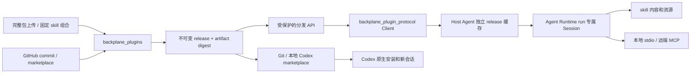

# Agent Plugins：发布、同步、安装与会话执行

实现评审，最后检查于 2026-10-23。对应已批准设计 Agent Note
`22fadaea-6cfe-461f-8721-3c6b446bccb2`。
代码最初开发于 `codex/agent-plugins`，基于 `e8317e799b8c7bceb8831b6300a95bddd368d919`，
集成时纳入 `main@512066a9` 的 `1.10.32` 基线。本文描述仓库实现；尚未发布 Hex 包或部署服务。

## 目标和边界

Backplane 保存和分发完整的 Agent Plugins 1.0.0 包，让消费端使用同一确定 release。
标准包、平台发布记录、消费端运行状态分别建模。Skills 的现有独立管理入口继续存在；
组合插件时复制选定的不可变 skill revision，包括脚本、引用和资源。

本次提供共享协议包、registry、Host Agent 安装 API、真实 Runtime、Codex 分发和管理 UI。
Sigma/Synapsis 后续使用这些接口接入产品；本仓库的宿主验证不代表它们已经完成集成。
插件执行使用宿主进程的权限，本实现不提供操作系统沙箱。

## 所有权和数据流



| 所属应用 | 实际职责 |
| --- | --- |
| `backplane_plugin_protocol` | 独立 Hex 包；离线 manifest/MCP 校验、组件发现、安全归档、完整性校验、注入传输的分发客户端 |
| `backplane_plugins` | 发布者身份、不可变制品、来源同步、channels、desired/actual 安装记录、Codex 导出 |
| `backplane_agent_runtime` | `Plugins.Session`、run 专属工具目录、skill 资源接口、MCP 连接和关闭 |
| `backplane_host_agent` | `AgentPlugins` 的缓存、staging、升级、回滚、启用选择、状态上报和本地 Codex 导出 |
| `backplane_system` | 共享 Repo、vault 和迁移 `20261023000000_create_plugin_registry.exs` |
| `backplane_api` / `backplane_admin` | 公共分发/管理 API；`/plugins`、`/plugins/sources`、`/plugins/releases`、`/plugins/distribution` |

新增 `plugin_sources`、`plugins`、`plugin_releases`、`plugin_channels` 和
`plugin_installations` 表。完整压缩制品保存在 release 的数据库字段中，使用现有备份边界；
此版没有单独引入对象存储或 gateway 子系统。迁移通过现有 `mix ecto.migrate` 执行。

本地 umbrella 使用仓库中的协议实现；Runtime 独立包声明协议依赖下限 `1.10.32`。
发布时须核对最终包版本与依赖下限，并将新 Plugin 协议包纳入 Hex 发布流程；现有发布矩阵
尚未包含该包。先发布包含 origin/脱敏修复的 MCP 协议包和新 Plugin 协议包，再发布 Runtime。
本地验证通过不代表 Hex 已提供这些源码。

## 包格式与局部失败

根目录使用规范的 `plugin.json`、可选的 `mcp.json` 和 `skills/<name>/SKILL.md`。
schemas 随协议包提供，加载不下载 schema。缺少版本或非 SemVer 版本仍可导入；
平台使用 release UUID 和 SHA-256 标识实际内容。原始文件和解析索引分别保留。

manifest 致命错误拒绝插件，未知字段产生警告。无效 skill 只跳过该 skill；
无效 MCP 顶层只禁用 MCP，无效单个 server 只跳过该 server。
扩展原样保留；共享 Runtime 先提供 portable skills/MCP，对未支持的扩展提供诊断。
发布页面分开展示规范校验、客户端支持表和消费端组件报告；支持 shared Runtime
不代表 Sigma/Synapsis 已接入，Codex 专有扩展交由 native client 解释。

归档拒绝路径穿越、绝对路径、重复条目、符号链接和非普通文件，并限制条目数、深度和大小。
直接目录 Loader 另按文件系统解析后的 root 约束读取：允许指向 root 内的链接；
manifest 越界拒绝插件，skill/MCP 越界仅影响对应组件，其他资源越界只拒绝该路径。
链接循环和遍历限制仍检查。Archive 的导入/安装快照策略保持拒绝链接。
执行位随制品保存和恢复。只有 stdio 的 `args`、`env` 值和 `cwd` 替换
`${PLUGIN_ROOT}` / `${PLUGIN_DATA}`，仅替换一次；未知占位符保留，键名、command、远端 URL
和 headers 不替换。宿主凭证以每 server 的 `bindings` 单独注入，不写回包。

## 来源、发布与回滚

`Plugins.import_files/2`、`import_archive/2` 和 `compose/4` 创建候选版本。
`publish_release/2` 发布确定 release 并选择 channel。重复内容可复用既有记录，已发布制品
不随上游 branch、skill 或 channel 变化。选择旧 release 即可回退 channel。

Git 来源先解析 ref 为 commit，再从该 commit 读取文件。根目录、子目录和 marketplace
使用相同导入流程。marketplace 的远端条目分别固定自己的 commit；provenance 同时记录
catalog commit 和插件来源。每个无效条目留下安全、按索引定位的诊断，其他有效条目继续导入。
整个同步失败时保留上次发布内容和失败记录。删除来源不卸载消费端插件。

`Scheduler` 每 30 秒检查到期来源，每个来源配置自己的间隔，最短 60 秒；停用来源不参与定时同步。
手动同步仍可使用。GitHub HTTPS 来源可引用 vault 凭证；Git 命令关闭交互认证和 hooks，
错误记录不包含原始输出或凭证。导入不会启动 MCP 或修改全局 gateway ToolRegistry。

## API 与认证

前缀为 `/plugin-protocol/v1`。这是 Backplane 自己的分发协议，Agent Plugins 1.0 规定包格式。
复用现有 MCP protected resource，沿用其开放开发环境、DB client、OAuth 和 authority unavailable
语义；新增独立 plugin scopes。

| API | 所需 scope | 行为 |
| --- | --- | --- |
| `GET /catalog`、`GET /resolve?plugin_id=...` | `plugin::read` | channel 默认 `stable`；resolve 可指定 `release_id` |
| `GET /artifacts/:digest` | `plugin::read` | 仅已发布制品；gzip、ETag/304 和 digest 校验 |
| `GET /installations` | `plugin::read` | 已认证消费端只能读 `client:<client_id>` 的目标记录 |
| `POST /installations/:id/report` | `plugin::install` | 同一目标限制；实际上报与 desired 分开 |
| `GET /plugins`、`GET /plugins/:id/releases` | `plugin::manage` | 管理目录和候选/历史版本 |
| `POST /releases`、`POST /compose`、`POST /releases/:id/publish` | `plugin::manage` | 上传、组合与发布 |
| `GET/POST /sources`、`PATCH/DELETE /sources/:id`、`POST /sources/:id/sync` | `plugin::manage` | 来源管理 |
| `POST /installations` | `plugin::manage` | 设置 target、plugin_id、release_id 和 enabled |

上传字段为 `archive_base64`，可选 `publisher`、`identity`。
组合字段为 `manifest`、`skills`（每项具有 `skill_id`、不可变 `revision`、`name`），
以及可选 `files_base64`（包内相对路径到 Base64 文件内容的对象）。`mcp.json` 也通过该对象添加。
发布字段为 `channel`。状态上报接受 `actual_release_id`、`actual_enabled`、`status`、`components`；
只保存允许的组件状态和通用诊断，舍弃任意原始 provider 错误或秘密字段。

`Client` 不依赖 Phoenix/Repo；调用者提供 HTTP transport 和认证。transport 负责 TLS、超时、
接收大小与不向其他 origin 转发认证。共享 `Client.download/3` 再验证 digest、归档和组件。
不设置自动重定向的 Req 适配示例：

```elixir
client = Backplane.PluginProtocol.Client.new(
  base_url: "https://gateway.example",
  auth: access_token,
  transport: fn request ->
    case Req.request(method: request.method, url: request.url, headers: request.headers,
           body: request.body, decode_body: false, redirect: false, retry: false) do
      {:ok, response} -> {:ok, %{status: response.status, body: response.body}}
      {:error, reason} -> {:error, reason}
    end
  end
)
```

## Host Agent 与共享 Runtime 接入

`AgentPlugins` 是显式调用的共享安装接口，未修改已有 WebSocket skills 同步循环。
消费端可调用 `reconcile/2` 获取自己 target 的 desired 记录，安装后上报结果，或按下面步骤逐项控制。
默认安装目录是 `~/.backplane/plugins`；可通过 `root:` 指定宿主目录。

```elixir
alias Backplane.HostAgent.AgentPlugins
alias Backplane.AgentRuntime.Plugins.Session

{:ok, installed} = AgentPlugins.install(client, plugin_id, release_id: release_id)
{:ok, enabled} = AgentPlugins.set_enabled(plugin_id, true)
{:ok, session} = Session.start_link(
  installation: enabled, run_id: run_id,
  bindings: %{"remote" => %{"headers" => %{"Authorization" => "Bearer " <> secret}}}
)
{:ok, catalog} = Session.catalog(session, run_id)
snapshot = Session.snapshot(session)
{:ok, skill} = Session.load_skill(session, run_id, "skills/example/SKILL.md")
# 宿主把 catalog.registry / authority / tools 接入既有 run 工具目录，并消费 skill 指令。
Session.stop(session)
```

每个插件使用哈希身份目录，内容位于 `releases/<digest>/plugin`，数据独立放在 `data`。
准备、校验和 staging 完成后原子切换安装记录；失败保留旧记录。历史 release 缓存保留供回滚，
升级不删 `PLUGIN_DATA`。缓存重用检查全部文件和模式；已有目录的 symlink ancestor 会被拒绝。
当前同一个 BEAM 内的安装操作串行化，目录应由单个 Host Agent 实例拥有。

Session 在启动时读取确定 release 并检查 Host 提供的 `content_digest`；手工构造的 installation
可省略该字段，这时调用者承担目录完整性责任。安装目录仍应由宿主按不可变目录管理。
Session 的内存快照、skill 身份和 MCP 连接属于同一 run。升级安装指针不会切换旧 Session。
传入 `enabled: false` 不会激活。此 API 不将任意磁盘目录变成只读操作系统挂载。

每个 server 单独启动和 admission，畸形 catalog、无效 schema、启动/认证失败会关闭该连接，
保留 skills 和其他 server。原生 MCP loader 等待 ready，读取 tools/list 全部分页；重复 cursor
或超时失败保持局部边界。工具调用校验 run，工具经现有 ToolCatalog 进入宿主授权边界。
stdio 的 cwd 限制在插件或其 data 目录，两个保留环境变量由宿主最后设置。远端 MCP 的请求、
重定向和旧 SSE endpoint event 都限制在配置 origin，协议层仍负责生成保留请求 headers。
会话停止或所拥有的 supervisor 退出后，相应连接关闭或工具标记不可用。

诊断不保存 bound secrets；Session 和协议 transport 的 OTP status/crash 输出也进行脱敏。
相关协议修复分别跟踪在 [#77](https://github.com/gsmlg-opt/backplane/issues/77)
与 [#78](https://github.com/gsmlg-opt/backplane/issues/78)。

## Codex 分发

`Plugins.Codex.export/2` 导出新目录；`snapshot/1` 可取得文件和 release 映射；
`publish_git/2` 显式生成、提交并推送指定 HTTPS Git repository/branch，使用 vault credential。
只清理上次映射中属于本导出的插件目录，保留其他仓库内容。
目标支持 GitHub/Gitea 等 HTTPS Git 服务，来源同步仍限制为 GitHub。
凭证使用 HTTP Basic token，metadata `git_username` 默认为 `x-access-token`；目标服务须支持
此认证方式。header 限定到该目标 URL，发布关闭 HTTP redirects；不接受 URL 内嵌凭证、
query、fragment 或 SSH。测试的本地 bare repository 通过显式 fixture 选项启用。

输出包含 `.agents/plugins/marketplace.json`、`plugins/<plugin UUID>/...` 和
`.agents/plugins/backplane-releases.json`。映射保存平台 release/digest，不改写第三方 manifest。
`channel:` 选择各插件版本，`plugin_ids:` 可进一步指定插件范围。Host Agent 同样支持从已安装
release 生成本地 marketplace，且校验当前缓存没有被修改。

Codex 0.163.0 实测要求条目名称等于包内 manifest.name。跨发布者同名时，一个 marketplace
导出返回 `duplicate_codex_plugin_name`；操作者明确选择一个发布者，或分开 channel/marketplace。
数据库插件身份仍然独立，不按名称合并，也不通过悄悄改包名来规避客户端规则。
导出名称取自所选 release 的 manifest；同一身份改名后仍能导出名称正确的旧 release。

该 Codex 版本的原生操作为：

```sh
codex plugin marketplace add /path/to/export --json
codex plugin add plugin-name@backplane --json
# Git 来源更新时先执行 codex plugin marketplace upgrade，再重新 add 插件。
# 本地来源更新后重新 add 同一插件，然后创建新会话。
```

实测在上游 `version` 仍为 `1.0.0` 时，更新本地来源后，仅修改来源不会更改已安装副本；
重新 `plugin add` 会复制新内容，新会话才作为此次验收目标。
不承诺 Codex 现有会话热更新或其缓存具有共享 Runtime 的目录锁定语义。

## 验证与交付限制

自动验证覆盖协议解析/打包、完整文件与执行位、固定 Git snapshots、第三方 marketplace、
失败保留旧发布、组合快照、channels、desired/actual、API scopes/目标隔离、Host 升级/回滚/数据保留、
真实 stdio MCP、分页、run 隔离、畸形 catalog 的资源回收，以及管理页面操作和导航。
协议包独立 `mix hex.build` 通过。精确命令与原生客户端验收说明见 [验证记录](agent-plugins-verification.md)。

手工验收使用标准样例 `apps/backplane_agent_runtime/examples/plugin`，包括 skill、Python 脚本、
marker 资源和 MCP。真实 Codex CLI/app-server 在隔离配置/缓存下安装平台导出的 V1/V2，
新会话发现 skill、连接 MCP、工具调用分别返回两个 marker。生成的 Git marketplace 也经
本地 Git HTTP fixture 克隆、安装并调用 MCP；这验证 Git 通道格式，不代表远端 GitHub 写入。

管理页在独立测试端口 4421、数据库 sandbox 事务和本 worktree 资产下进行浏览器检查，
验证 LiveView 已连接、渠道回退、来源/分发页面、桌面/窄屏布局和 console。
测试数据不代表生产安装状态。

明确限制：GitHub 真正的远端凭证/推送未执行；完整 Git tree 中的 symlink/submodule 当前会导致
来源快照拒绝，包含无关目录的此类条目也一样。自动源同步尚无远端生产运行证明。
Gitea 的实际认证未验收；Git 子进程尚无独立的硬性超时，停滞的网络命令可能占用同步任务与数据库连接。
尚未发布/部署，也未接入 Sigma/Synapsis 产品；独立 Host Agent 的现有 WebSocket 同步循环不会
自动调用新安装 API。未运行全仓库测试、全仓库 Dialyzer 或发布 CI。
