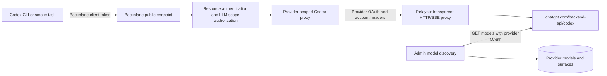

# Backplane OpenAI Codex Responses Proxy

Backplane provides a provider-scoped transparent proxy for OpenAI Codex clients.
It forwards raw Responses API request bytes, query strings, JSON responses, SSE
events, and upstream errors unchanged.

## Architecture



Direct client traffic and management model discovery are separate paths. The
direct proxy does not require a model to be present in the local catalog; the
upstream account and rollout decide whether a slug is available.

## Routes

```text
GET  /v1/providers/openai-codex/models
POST /v1/providers/openai-codex/responses
POST /v1/providers/openai-codex/responses/compact
```

They map, respectively, to `/models`, `/responses`, and `/responses/compact` on
the configured ChatGPT Codex backend. `/v1` is never repeated in the upstream
path. Query parameters, including `client_version`, are preserved.

`/responses/compact` is retained as a transparent legacy compatibility route.
Current Codex clients use remote compaction v2 instead: they POST an SSE request
to `/responses`, include `x-codex-beta-features: remote_compaction_v2`, and add a
`compaction_trigger` input item. Backplane forwards that flow without interpreting
or rewriting it.

### Encrypted History and Notes

Use the same provider-scoped base URL for the session's `POST /responses` and all
of its model-less History and Notes operations. For example, with base URL
`https://backplane.example/v1/providers/openai-codex`, post to the following
relative paths. Backplane forwards each path relative to that provider's
configured Codex backend.

| Relative path | Allowed operations |
| --- | --- |
| `alpha/history/v2/<operation>` | `list_windows`, `list_items`, `read_item`, `search_contents` |
| `alpha/notes/v2/<operation>` | `list_files_by_prefix`, `read_file`, `search_contents`, `append_to_file`, `write_file` |

The optional context endpoint `POST alpha/notes/v2/thread_hint` uses the same
provider, trusted session/agent context and scope. Codex calls it when assembling
context and consumes its `text` result as a hint. The caller supplies
`x-openai-tool-output-truncation-policy` with a 4,000-byte limit. A failed hint
request lets Codex continue assembling context. The nine model-facing tool
operations remain available independently of this hint request.
[Codex context contributor](https://github.com/openai/codex/blob/ccf9be8cc458bd6b8336fe84d68d8893f2691a5e/codex-rs/ext/history-notes/src/extension.rs#L97)

Grant the trusted runtime host an explicit `llm::codex-history-notes` scope on its
Backplane bearer credential, plus `llm::invoke` for Responses. Grant the exact
scope even when the host has wildcard permissions. Keep the provider and
its upstream account fixed for the lifetime of the session. The host supplies
`context.session_id` and `context.current_agent_name` from its own session state
and retains control of provider selection. Backplane forwards that context as
supplied by the authenticated host. The upstream owns session and agent semantics.

Backplane forwards the JSON bytes and the `x-openai-encrypted-tool-arguments` and
`x-openai-tool-output-truncation-policy` headers. Upstream status and response
bytes, including `encrypted_output` and ordered `images`, pass through. Enable
the runtime's encrypted mode only for a backend and account with the extension
enabled. The [pinned Codex backend source](https://github.com/openai/codex/blob/46fdd5ef39735f4159cdcf0ec5e85c10521494e5/codex-rs/ext/history-notes/src/backend.rs)
defines the request context and headers.

#### Verify with Sigma

For a Sigma-owned archive, leave `codexHistoryNotes` unset or set it to
`false`. Start a saved session with native tools. A consumer using the
Responses codec's `:local` mode presents the tools to the model as
`local_history` and `local_notes`. Ask the model to write a test note, reopen
the session and ask it to read the note and find the earlier user message.
The journal records `notes::write_file`, `notes::read_file` and
`history::search_contents` with their local results. This mode only requires
Responses access to the provider.

In a Sigma build with the encrypted History/Notes adapter, select a provider
entry with `api: "openai-responses"`,
`baseUrl` set to the provider-scoped Backplane URL, and
`codexHistoryNotes: true`. Start a new saved session with its native tools.
Ask it to call `history.list_windows`, then `notes.list_files_by_prefix` for a
synthetic prefix. Inspect each tool result in the session journal. A model can
finish a turn after receiving tool errors. To qualify encrypted replay, have
the model call `history.search_contents` for text from that session and verify
that the next Responses request carries the returned `encrypted_content`.

| Observation | What to check |
| --- | --- |
| The model rejects a tool declaration on `/responses` | Inspect the Sigma wire tool name and schema. This request failed before tool execution. |
| An unscoped `/v1/alpha/...` request returns `404 unsupported_api_route` | Use the same `/v1/providers/<name>` base URL as the original Responses request. |
| The scoped operation returns `401 authentication_required` or `403 insufficient_scope` | Check the host's Backplane bearer credential and its exact `llm::codex-history-notes` grant. |
| The scoped operation forwards an upstream 404 | Check the selected backend and account with the same session context. Model discovery and a successful Responses turn establish inference access. The alpha operations need their own successful call. |

## Codex configuration

```toml
model = "gpt-5.6-sol"
model_provider = "backplane-codex"

[model_providers.backplane-codex]
name = "Backplane OpenAI Codex"
base_url = "https://backplane.example/v1/providers/openai-codex"
env_key = "BACKPLANE_API_KEY"
wire_api = "responses"
supports_websockets = false
```

Management discovery always sends `client_version`. An explicit
`OPENAI_CODEX_CLIENT_VERSION` environment variable or
`:openai_codex_client_version` application setting takes precedence; otherwise
Backplane fetches the latest non-draft GitHub release from
`openai/codex` and uses its semantic version. If GitHub is unavailable, it
uses the installed `codex --version` result and then falls back to the backend
compatibility sentinel `0.0.0`. Direct client query parameters are forwarded
unchanged.

## Credential requirements

The provider must use the `openai-codex` preset, an enabled OpenAI API surface,
and a credential whose auth type is `openai_oauth`. Backplane injects the
refreshed OAuth bearer token and `ChatGPT-Account-ID`, replacing any client
auth headers. Shared Provider default headers and API-specific default headers
are merged case-insensitively with API-specific defaults overriding Provider
defaults; these configured defaults are applied only when the client has not
sent that header (`originator` uses this put-if-absent behavior). Protected
credential and account headers cannot be replaced by callers or configured
defaults.

Responses WebSockets are intentionally disabled. HTTP and SSE are the only
accepted transport paths.

## Access and usage observation

Direct Codex requests participate in normal Backplane LLM access observation
(`llm_logs` / Observability v2) while preserving raw/compressed request bytes,
query strings, headers, and SSE bytes. `POST /responses` and
`POST /responses/compact` observe upstream usage incrementally when LLM proxy
observability is enabled, leaving missing usage unknown and never fabricating
completion on transport EOF. `GET /models` and encrypted History/Notes routes
emit access metadata only without parsing or logging response bodies.
Observation failures never block or abort forwarding.

## Models

The provider-scoped `/models` endpoint returns the Codex backend's account- and
rollout-specific schema unchanged. Management discovery separately parses
`models[].slug`, persists unknown metadata, and keeps the previous catalog when
discovery fails or returns an empty result. Manual models are never removed.

For example, a current Codex catalog may contain `gpt-5.6-sol`,
`gpt-5.6-terra`, `gpt-5.6-luna`, `gpt-5.5`, `gpt-5.4`, `gpt-5.4-mini`, and
`gpt-5.3-codex-spark`. Backplane treats the upstream `slug` as authoritative
rather than synthesizing these names.

The global `/v1/models` endpoint remains OpenAI-compatible and is independent
from direct Codex routing. Its top-level response contains `object: "list"` and
`data`; each model may include normalized `data[].metadata`. The separate
`/v1/codex/models` endpoint returns exact descriptors imported from a selected
OpenAI Codex provider. Imports include every model in the provider's current
`/models` response. The admin catalog offers one Refresh Models action per provider
with saved models; it updates that provider's full snapshot while preserving each
model's enabled state. Preview JSON opens the effective response in a dialog. Disabled entries
and entries whose Responses route is unavailable are omitted. Saved entries
whose model disappears upstream remain stored for review. The direct Codex
endpoints remain provider-scoped; imported slugs also route through generic
`POST /v1/responses`. See
[LLM model metadata](llm-model-metadata.md) for the global listing contract.

## Chat Completions

OpenAI Codex providers support Responses only. Backplane does not convert Chat
Completions to Responses or Responses events to Chat Completions chunks.
Use `/v1/providers/openai-codex/responses` from Codex clients.

## Errors and troubleshooting

Backplane returns a local JSON error when a provider is absent, disabled, not
Codex-enabled, rate limited, or cannot provide a valid OAuth credential. Once
an upstream request starts, upstream status, headers, body, and SSE are passed
through unchanged.

If the backend returns `401`, refresh or re-import the ChatGPT OAuth credential.
If a new upstream model returns `404`, the direct route still allows the request;
the upstream decides account and rollout access.

## Security

Never send Backplane client bearer tokens through to ChatGPT. Backplane strips
or replaces provider-owned authorization headers. Telemetry records request
identity and status only; it does not log access tokens, refresh tokens, request
bodies, tool arguments, or prompts.

## Smoke test

Run a real opt-in test with an existing provider and model:

```sh
BACKPLANE_CODEX_SMOKE=true OPENAI_CODEX_CLIENT_VERSION=0.0.0 \
  BACKPLANE_API_KEY="$BACKPLANE_API_KEY" \
  mix backplane.codex.smoke --provider openai-codex --model gpt-5.6-sol
```

The command calls the Backplane public provider routes, not ChatGPT directly.
`BACKPLANE_API_KEY` is the Backplane client credential and may be omitted only
when the public endpoint is intentionally running in open mode. Set
`BACKPLANE_CODEX_BASE_URL` to override the default public API origin. The
command checks model discovery, a normal Responses turn, a forced function-tool
call, an additional streaming turn, and the current remote-compaction-v2 flow.
The ChatGPT Codex backend requires `stream: true`, so all live Responses probes
validate the native SSE protocol. Byte-preserving non-stream and legacy
`/responses/compact` behavior remain covered by local integration tests because
the currently verified ChatGPT rollout returns 404 for the legacy compact route. The
command prints statuses, request IDs, stream event counts, tool-call counts, and
compaction-item counts only. Any non-2xx response or missing expected model,
terminal SSE event, function call, or compaction item makes it exit with an error.
