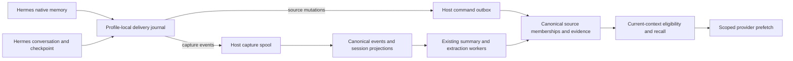

# Hermes memory integration

This document covers the Hermes provider, the local host agent, and canonical
Backplane Memory. The supported upstream contract is Hermes commit
`bac34e9e9946c9c6a9ce7ce64efadd47f8fa375b`. Installation and live verification are
separate from changing the packaged source.

Implementation and integrated verification are in progress. The contracts below
are the accepted implementation boundary; the verification section must be
completed before treating this document as a release record.

## Ownership and data flow

Native curated memory and conversation evidence use different paths. Native
`MEMORY.md`/`USER.md` changes maintain independently withdrawable source support.
Conversation messages enter the existing capture, session projection, summary,
and extraction pipeline. A captured assistant statement is not a user-confirmed
fact.



The Python journal stores delivery state and source identity mappings, not a
second canonical memory store. The host provides durable provisional acceptance;
Backplane remains the canonical authority. Cwd, repository, URL agent ID,
installation ID, and profile labels are provenance or selectors. They cannot
grant access or redefine a host-authorized partition.

## Source identity and ordering

A native source namespace is the authorized partition plus authenticated host,
integration, installation UUID, profile ID, and target (`memory` or `user`). An
adapter entry UUID identifies one entry within that namespace. Session IDs do
not participate in entry identity: edits in a later session keep the entry and
record the new session as revision provenance.

Three identities have distinct purposes:

| Identity | Meaning |
| --- | --- |
| `entry_id` | Durable native-entry mapping across edits |
| `event_id` | One immutable delivery, replayed without changing its payload |
| `canonical_id` | The served memory, potentially supported by several sources |

The adapter assigns a durable increasing sequence per source target. This is
`source_revision`; it is different from the canonical edge `revision`. A stale
mutation cannot overwrite a newer head or resurrect a withdrawn entry. Event
replay returns the saved receipt. Reusing its event ID with changed immutable
data produces a conflict without partial mutation.

Pinned Hermes stores native entries separated by `\n§\n`, with exact-content
deduplication, per-target locks and atomic file replacement. It does not store
entry UUIDs or revisions. The adapter maintains those mappings locally. Complete
`metadata.previous_content` may identify an unambiguous existing mapping; lookup
substrings, semantic similarity and content hashes are not entry identities.

Several native operations may share `tool_call_id`. Callback arrival can also
lag a later native write. The adapter durably records the observation and
converges against the current strictly read, locked target snapshot. A duplicate
native add without a source change does not manufacture another source revision.
The guarantee is immutable delivery and deterministic source convergence, not
reconstruction of callback occurrence IDs that Hermes never supplies.

Strict file reads bypass the manager's callback-egress filtering. Before wire
payloads are prepared, native snapshot contents and provenance must pass the
supported public `agent.memory_manager.redact_for_egress` API. Unavailable
redaction defers delivery; its failure sentinel is not memory content. Raw
identity mappings remain local. Distinct entries that redact to the same text
retain distinct source identities, and a redacted previous value is usable only
when its mapping is unambiguous.

## Versioned source API

Source operations are local transport methods, not model-facing housekeeping
tools:

```text
POST /memory/:agent_id/call/source_capabilities
POST /memory/:agent_id/call/source_mutate
POST /memory/:agent_id/call/source_reconcile
POST /memory/:agent_id/call/source_status
```

`memory_sources.v1` is negotiated separately within the existing
`memory_commands.v2` delivery protocol. An older peer returns an explicit
unsupported-capability result. Replacement and removal must never degrade to
append-only `remember` calls. Source writes require both existing `remember` and
`forget` grants under the same authority binding. Generic `remember` retains its
immutable request-idempotency contract.

A mutation has this shape; optional provenance is omitted when unavailable:

```json
{
  "protocol": "memory_sources.v1",
  "source": {
    "integration": "hermes",
    "installation_id": "<installation UUID>",
    "profile_id": "<profile ID>",
    "target": "memory"
  },
  "entry_id": "<entry UUID>",
  "event_id": "<immutable event UUID>",
  "revision": 17,
  "operation": "upsert",
  "content": "<complete native entry>",
  "type": "semantic",
  "occurred_at": "<original ISO8601 timestamp>",
  "provenance": {"session_id": "<actual session>"}
}
```

`withdraw` omits content. Provenance supports actual parent session, message and
tool occurrence references, author/role, write origin, execution context and
repository information. The optional `memory_access_id` selects an existing
authorized access. Caller-supplied host/client/partition ownership is rejected.
Queued work retains its original authority binding; a binding rejection is
terminal rather than an instruction to rebind and replay.

Receipts distinguish `pending`, `committed`, and `rejected`, with a separate
outcome (`applied`, `unchanged`, `stale`, or `suppressed`). They include the event
and command IDs, source revision, canonical ID/edge revision when known, and
`authority`/`consistency`. HTTP acceptance is not canonical commitment.
`source_status` accepts the source identity, event ID and optional access
selector. Capability reporting separates host-local support from actual
canonical negotiation/readiness.

## Reconciliation, withdrawal and forgetting

`source_reconcile` stages a bounded immutable manifest through `begin`, `page`,
`commit`, and `abort`. Begin records a reconciliation UUID, source fence revision,
page/entry counts and snapshot hash. Each page records its index, hash, and full
entries. Hashes are lowercase SHA256 over compact UTF-8 JSON with sorted object
keys; a page hashes its entries array and the snapshot hashes the flattened
page-ordered entries. Replay preserves the exact IDs and data.

Staging does not change effective memberships. Commit requires every page and a
complete successfully read source snapshot. At fence R it updates only heads at
or below R, preserving later live writes; unchanged entries retain their evidence.
Absence withdraws covered heads, and a reconciliation floor rejects delayed old
adds that were not previously known. Missing files, read/permission errors,
undecodable input and partial snapshots never imply an empty source. A
successfully read empty file can establish an empty target.

Withdrawal removes only that source's contribution. Identical independently
supported content remains eligible. If required support disappears, current
reads suppress the unsupported memory and its affected derived outputs before
background reprocessing finishes. Historical mutations and evidence remain
inspectable.

Global `forget` is a separate intentional operation. Existing tombstones and
derivation protections remain authoritative; source reconciliation is not
permission to undo forgetting. Rollback must preserve these suppressions.

## Capture, sessions and compression checkpoints

The Hermes adapter uses:

```text
POST /capture/v1/hooks/hermes/session-start
POST /capture/v1/hooks/hermes/message
POST /capture/v1/hooks/hermes/session-end
POST /capture/v1/hooks/hermes/pre-compress
POST /capture/v1/status
```

Capture input declares `hermes_capture.v1`, immutable event UUID, journal source
sequence, occurrence/capture timestamps, session ID, installation/profile, and
available message content, role, author, occurrence references and source
provenance. The host derives trusted ownership. Canonical stream allocation is
separate from the adapter source sequence.

Capture retains the existing host-private/default partition binding. It does
not accept a `memory_access_id` override. Source mutation can use a granted
selected shared access, but automatic capture/checkpoints refuse a selector
different from the reported default capture binding. This prevents conversations
intended for a selected access from silently entering the host's private
partition. An explicit selector equal to the default is compatible. An
incompatible or disabled capture path cannot report a successful v2 checkpoint.

Pinned Hermes persists `message_uid`, absorbed message UIDs and tool-occurrence
UIDs when durable message storage is enabled. These identities deduplicate
overlapping turn/checkpoint snapshots while preserving repeated text from
different occurrences. Provider `tool_call_id` alone is insufficient. Inputs
without durable UIDs require explicit compatibility behavior; content equality
cannot prove occurrence identity.

The accumulated `messages` argument is current context, not a promise of complete
historical archival. Missing messages do not establish withdrawal. Session-switch
callbacks supply session/parent/reset/rewound information but no authoritative
rewind cursor or replacement transcript. They change subsequent attribution and
invalidate scoped cache entries without inventing historical deletions.
Callback-supplied session IDs take precedence for delayed background work.

Checkpoint API v2 advertises
`on_pre_compress(messages, *, require_checkpoint=False)`. Every exception-free
return counts as success to Hermes, so evidence and mappings must be durably
journaled before return; persistence failures must raise. Return text supplies
references and never changes the caller's messages. Local journal commitment is
not a canonical acknowledgment. With Hermes's `compression.checkpoint_required`
enabled, a persistence exception prevents lossy compression.

Current v2 normalizes direct user/assistant evidence and preserves available
identities. It excludes system/tool/summary rows and strips assistant tool calls
while retaining prose. This is not an archive of the entire original transcript.
Supported-size evidence is retained in full; any excerpt must carry original
length/hash, truncation/coverage and a truthful source reference. Old truncated
turns cannot be reconstructed without originals.

## Delivery, current context and trust

The bounded journal worker retains immutable deliveries through process exit,
host outages and lost acknowledgments. Retryable transport failures use bounded
backoff; terminal authority/validation failures remain rejected for inspection.
Shutdown has a bounded drain/join and does not determine durability. Observable
states distinguish local pending, host accepted, canonical committed and rejected.
Diagnostics expose safe codes/identities, not memory bodies or credentials.

Automatic context shares one eligibility policy across canonical reads, edge
mirrors, provisional overlays and provider caches. Deleted, expired, archived,
superseded, withdrawn and explicitly forgotten contributions are excluded. Pending
corrections suppress older source content before canonical acknowledgment;
insufficient offline support metadata requires conservative suppression.
Authorization or validation rejection cannot trigger local fallback.

Relevance rejection uses lexical evidence or calibrated raw semantic/reranker
scores tied to the configured model, not rank-fusion scores as probabilities.
Unknown calibration falls back to supported lexical matches, and unrelated
queries may return zero. Whole entries are packed with labels/references inside a
final rendering budget; arbitrary character slices are not a memory policy.
Raw evidence, candidate inferences and established facts retain distinct trust
labels. An assistant write or request receipt alone is not user confirmation.

`is_available` checks local configuration/dependencies only.
`system_prompt_block` contains static instructions. `queue_prefetch` fills a
bounded cache consumed by `prefetch`; keys include binding/profile/session/query
and policy/freshness. Corrections, withdrawal, session changes and revocation
invalidate applicable entries. Offline freshness is bounded and cannot reveal
remote changes that have not reached the host.

## Rollout and operational limits

Roll out canonical migrations/capabilities, then the host, then the packaged
provider. Follow [the Memory release gates](../deploy/memory-v2-release.md).
Installation must explicitly update the user's Hermes plugin; a changed
repository or packaged archive does not establish that an installed plugin is
running the new code.

Legacy import/reconciliation must default to dry-run, page reliable Hermes
provenance only, retain original IDs, mark known excerpts, report ambiguity and
save a resumable cursor. Do not guess native identities or destructively replay
real operator data during development. Operator-controlled application is a
separate rollout action.

Disabling the provider stops new capture while preserving its journal and source
suppression history. Do not delete those files as an outage remedy. Do not
down-migrate the source tables or roll back to a reader that ignores effective
support after withdrawals have been applied; it can expose obsolete content.

## Verification and release evidence

The 2026-10-24 workspace checkpoint is incomplete and is not a release record.
The source-tree Python Hermes suite passed 60 tests. A focused BEAM run completed
198 tests with two failures; the separate canonical snapshot builder suite
passed three tests. Test-environment compilation with warnings as errors passed.
The initial formatting check found one indentation issue in the new pipeline
test; that file was formatted before committing this checkpoint.
The final scoped formatting and diff checks passed, as did the release-config
suite (31 tests) and CI-workflow suite (eight tests).

The two failing assertions are the new Hermes pipeline test expecting direct
event evidence where the extraction result retains summary evidence, and the
existing episodic worker test expecting four evidence rows where derived writes
now retain two. Neither failure has been repaired or waived. A prior isolated
spool run also failed when `delivery_fingerprint/1` converted a field with
`String.to_existing_atom/1`; the combined run did not reproduce it, and the
load-order dependency remains unresolved.

Integrated implementation verification remains pending. Required evidence includes
source add/replace/remove and independent support; immutable replay/conflict;
snapshot fencing; crash/lost-ACK/restart recovery; real provider-to-host HTTP and
canonical readback; capture-to-extraction lineage; current-context relevance,
trust and budget; pinned Hermes checkpoint behavior; and legacy-client
compatibility. Unit, contract, live, CI, release and deployment evidence must be
reported separately.
