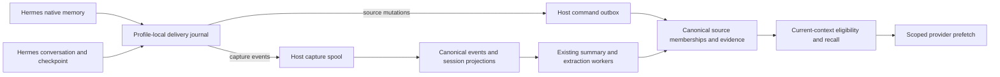

# Hermes memory integration

This document covers the Hermes provider, the local host agent, and canonical
Backplane Memory. The supported upstream contract is Hermes commit
`bac34e9e9946c9c6a9ce7ce64efadd47f8fa375b`. Installation and live verification are
separate from changing the packaged source.

Implementation and integrated verification are in progress. The contracts below
are the accepted implementation boundary; the verification section must be
completed before treating this document as a release record.

## Ownership and data flow

Native curated memory and conversation evidence use different paths. Native
`MEMORY.md`/`USER.md` changes maintain independently withdrawable source support.
Conversation messages enter the existing capture, session projection, summary,
and extraction pipeline. A captured assistant statement is not a user-confirmed
fact.



The Python journal stores delivery state and source identity mappings, not a
second canonical memory store. The host provides durable provisional acceptance;
Backplane remains the canonical authority. Cwd, repository, URL agent ID,
installation ID, and profile labels are provenance or selectors. They cannot
grant access or redefine a host-authorized partition.

## Source identity and ordering

A native source namespace is the authorized partition plus authenticated host,
integration, installation UUID, profile ID, and target (`memory` or `user`). An
adapter entry UUID identifies one entry within that namespace. Session IDs do
not participate in entry identity: edits in a later session keep the entry and
record the new session as revision provenance.

Three identities have distinct purposes:

| Identity | Meaning |
| --- | --- |
| `entry_id` | Durable native-entry mapping across edits |
| `event_id` | One immutable delivery, replayed without changing its payload |
| `canonical_id` | The served memory, potentially supported by several sources |

The adapter assigns a durable increasing sequence per source target. This is
`source_revision`; it is different from the canonical edge `revision`. A stale
mutation cannot overwrite a newer head or resurrect a withdrawn entry. Event
replay returns the saved receipt. Reusing its event ID with changed immutable
data produces a conflict without partial mutation.

Pinned Hermes stores native entries separated by `\n§\n`, with exact-content
deduplication, per-target locks and atomic file replacement. It does not store
entry UUIDs or revisions. The adapter maintains those mappings locally. Complete
`metadata.previous_content` may identify an unambiguous existing mapping; lookup
substrings, semantic similarity and content hashes are not entry identities.

Several native operations may share `tool_call_id`. Callback arrival can also
lag a later native write. The adapter durably records the observation and
converges against the current strictly read, locked target snapshot. A duplicate
native add without a source change does not manufacture another source revision.
The guarantee is immutable delivery and deterministic source convergence, not
reconstruction of callback occurrence IDs that Hermes never supplies.

Strict file reads bypass the manager's callback-egress filtering. Before wire
payloads are prepared, native snapshot contents and provenance must pass the
supported public `agent.memory_manager.redact_for_egress` API. Unavailable
redaction defers delivery; its failure sentinel is not memory content. Raw
identity mappings remain local. Distinct entries that redact to the same text
retain distinct source identities, and a redacted previous value is usable only
when its mapping is unambiguous.

## Versioned source API

Source operations are local transport methods, not model-facing housekeeping
tools:

```text
POST /memory/:agent_id/call/source_capabilities
POST /memory/:agent_id/call/source_mutate
POST /memory/:agent_id/call/source_reconcile
POST /memory/:agent_id/call/source_status
```

`memory_sources.v1` is negotiated separately within the existing
`memory_commands.v2` delivery protocol. An older peer returns an explicit
unsupported-capability result. Replacement and removal must never degrade to
append-only `remember` calls. Source writes require both existing `remember` and
`forget` grants under the same authority binding. Generic `remember` retains its
immutable request-idempotency contract.

A mutation has this shape; optional provenance is omitted when unavailable:

```json
{
  "protocol": "memory_sources.v1",
  "source": {
    "integration": "hermes",
    "installation_id": "<installation UUID>",
    "profile_id": "<profile ID>",
    "target": "memory"
  },
  "entry_id": "<entry UUID>",
  "event_id": "<immutable event UUID>",
  "revision": 17,
  "operation": "upsert",
  "content": "<complete native entry>",
  "type": "semantic",
  "occurred_at": "<original ISO8601 timestamp>",
  "provenance": {"session_id": "<actual session>"}
}
```

`withdraw` omits content. Provenance supports actual parent session, message and
tool occurrence references, author/role, write origin, execution context and
repository information. The optional `memory_access_id` selects an existing
authorized access. Caller-supplied host/client/partition ownership is rejected.
Queued work retains its original authority binding; a binding rejection is
terminal rather than an instruction to rebind and replay.

Receipts distinguish `pending`, `committed`, and `rejected`, with a separate
outcome (`applied`, `unchanged`, `stale`, or `suppressed`). They include the event
and command IDs, source revision, canonical ID/edge revision when known, and
`authority`/`consistency`. HTTP acceptance is not canonical commitment.
`source_status` accepts the source identity, event ID and optional access
selector. Capability reporting separates host-local support from actual
canonical negotiation/readiness.

## Reconciliation, withdrawal and forgetting

`source_reconcile` stages a bounded immutable manifest through `begin`, `page`,
`commit`, and `abort`. Begin records a reconciliation UUID, source fence revision,
page/entry counts and snapshot hash. Each page records its index, hash, and full
entries. Hashes are lowercase SHA256 over compact UTF-8 JSON with sorted object
keys; a page hashes its entries array and the snapshot hashes the flattened
page-ordered entries. Replay preserves the exact IDs and data.

Staging does not change effective memberships. Commit requires every page and a
complete successfully read source snapshot. At fence R it updates only heads at
or below R, preserving later live writes; unchanged entries retain their evidence.
Absence withdraws covered heads, and a reconciliation floor rejects delayed old
adds that were not previously known. Missing files, read/permission errors,
undecodable input and partial snapshots never imply an empty source. A
successfully read empty file can establish an empty target.

Withdrawal removes only that source's contribution. Identical independently
supported content remains eligible. If required support disappears, current
reads suppress the unsupported memory and its affected derived outputs before
background reprocessing finishes. Historical mutations and evidence remain
inspectable.

Global `forget` is a separate intentional operation. Existing tombstones and
derivation protections remain authoritative; source reconciliation is not
permission to undo forgetting. Rollback must preserve these suppressions.

## Capture, sessions and compression checkpoints

The Hermes adapter uses:

```text
POST /capture/v1/hooks/hermes/session-start
POST /capture/v1/hooks/hermes/message
POST /capture/v1/hooks/hermes/session-end
POST /capture/v1/hooks/hermes/pre-compress
POST /capture/v1/status
```

Capture input declares `hermes_capture.v1`, immutable event UUID, journal source
sequence, occurrence/capture timestamps, session ID, installation/profile, and
available message content, role, author, occurrence references and source
provenance. The host derives trusted ownership. Canonical stream allocation is
separate from the adapter source sequence.

Capture retains the existing host-private/default partition binding. It does
not accept a `memory_access_id` override. Source mutation can use a granted
selected shared access, but automatic capture/checkpoints refuse a selector
different from the reported default capture binding. This prevents conversations
intended for a selected access from silently entering the host's private
partition. An explicit selector equal to the default is compatible. An
incompatible or disabled capture path cannot report a successful v2 checkpoint.

Pinned Hermes persists `message_uid`, absorbed message UIDs and tool-occurrence
UIDs when durable message storage is enabled. These identities deduplicate
overlapping turn/checkpoint snapshots while preserving repeated text from
different occurrences. Provider `tool_call_id` alone is insufficient. Inputs
without durable UIDs require explicit compatibility behavior; content equality
cannot prove occurrence identity.

The accumulated `messages` argument is current context, not a promise of complete
historical archival. Missing messages do not establish withdrawal. Session-switch
callbacks supply session/parent/reset/rewound information but no authoritative
rewind cursor or replacement transcript. They change subsequent attribution and
invalidate scoped cache entries without inventing historical deletions.
Callback-supplied session IDs take precedence for delayed background work.

Checkpoint API v2 advertises
`on_pre_compress(messages, *, require_checkpoint=False)`. Every exception-free
return counts as success to Hermes, so evidence and mappings must be durably
journaled before return; persistence failures must raise. Return text supplies
references and never changes the caller's messages. Local journal commitment is
not a canonical acknowledgment. With Hermes's `compression.checkpoint_required`
enabled, a persistence exception prevents lossy compression.

Current v2 normalizes direct user/assistant evidence and preserves available
identities. It excludes system/tool/summary rows and strips assistant tool calls
while retaining prose. This is not an archive of the entire original transcript.
Supported-size evidence is retained in full; any excerpt must carry original
length/hash, truncation/coverage and a truthful source reference. Old truncated
turns cannot be reconstructed without originals.

## Delivery, current context and trust

The bounded journal worker retains immutable deliveries through process exit,
host outages and lost acknowledgments. Retryable transport failures use bounded
backoff; terminal authority/validation failures remain rejected for inspection.
Shutdown has a bounded drain/join and does not determine durability. Observable
states distinguish local pending, host accepted, canonical committed and rejected.
Diagnostics expose safe codes/identities, not memory bodies or credentials.

Automatic context shares one eligibility policy across canonical reads, edge
mirrors, provisional overlays and provider caches. Deleted, expired, archived,
superseded, withdrawn and explicitly forgotten contributions are excluded. Pending
corrections suppress older source content before canonical acknowledgment;
insufficient offline support metadata requires conservative suppression.
Authorization or validation rejection cannot trigger local fallback.

New canonical candidates start unpublished (`effective_support=false`) until the
existing support projection has attached the request and real input evidence.
Source mutations wait for their source membership too. This prevents an initial
edge payload from claiming independent support before evidence exists, allocating
an extra revision, or producing an oversized-item tombstone for an entry that was
never published. Migration `20261024000004` makes old-row edge eligibility respect
that unpublished state. A supported entry's later withdrawal still emits its
normal tombstone.

New source/derived writes retain request traceability without inventing support:
their request evidence is `derives` with score `0.0`, and the request keeps its
actual origin and `independent_support=false`. Mutation, summary and event roots
remain the governing evidence. This change does not backfill historical request
receipts or infer missing legacy source identities.

Relevance rejection uses lexical evidence or calibrated raw semantic/reranker
scores tied to the configured model, not rank-fusion scores as probabilities.
Unknown calibration falls back to supported lexical matches, and unrelated
queries may return zero. Whole entries are packed with labels/references inside a
final rendering budget; arbitrary character slices are not a memory policy.
Raw evidence, candidate inferences and established facts retain distinct trust
labels. An assistant write or request receipt alone is not user confirmation.

Parallel recall channels may straddle a bookkeeping or embedding update. Fusion
coalesces otherwise identical candidates when only their integer context revision
differs, keeping the newest revision. Content, partition, evidence, trust,
support, source references and every other candidate field must still match
exactly; substantive conflicts continue to fail closed.

The existing Memory configuration surface exposes the canonical calibration:

| Setting | Default | Meaning |
|---|---|---|
| `memory.recall_relevance_vector_model` | unset | Exact embedding model whose raw cosine cutoff was calibrated |
| `memory.recall_relevance_vector_min` | `1.0` | Minimum raw cosine, in `-1..1`; inactive without a calibrated model |
| `memory.recall_relevance_reranker_model` | unset | Literal `provider/raw_model` route whose relevance cutoff was calibrated |
| `memory.recall_relevance_reranker_min` | `1.0` | Minimum raw reranker score, in `0..1`; inactive without a calibrated route |

Model selectors and cutoffs must be calibrated together for the actual retrieval
workload. Retargetable reranker aliases cannot establish model identity. Missing
calibration, a changed model, or unavailable semantic providers leaves lexical
matches eligible; a calibrated weak reranker result rejects semantic-only
candidates. The synthetic cosine measurements below are diagnostic examples,
not an operator calibration.

Canonical `memory.recall_token_budget` defaults to 4096. An explicit request
budget is supported by both recall paths, and the host applies the final budget
again after canonical/provisional merging. The provider's separate
`context_token_budget` defaults to 1200 and includes all rendered labels,
identities, revisions and separators. UTF-8 byte counts conservatively bound
byte-tokenizer tokens; oversized entries are skipped whole rather than sliced.

`is_available` checks local configuration/dependencies only.
`system_prompt_block` contains static instructions. `queue_prefetch` fills a
bounded cache consumed by `prefetch`; keys include binding/profile/session/query
and policy/freshness. Corrections, withdrawal, session changes and revocation
invalidate applicable entries. Offline freshness is bounded and cannot reveal
remote changes that have not reached the host.

## Rollout and operational limits

Roll out canonical migrations/capabilities, then the host, then the packaged
provider. Follow [the Memory release gates](../deploy/memory-v2-release.md).
Installation must explicitly update the user's Hermes plugin; a changed
repository or packaged archive does not establish that an installed plugin is
running the new code.

Legacy import/reconciliation must default to dry-run, page reliable Hermes
provenance only, retain original IDs, mark known excerpts, report ambiguity and
save a resumable cursor. Do not guess native identities or destructively replay
real operator data during development. Operator-controlled application is a
separate rollout action.

Disabling the provider stops new capture while preserving its journal and source
suppression history. Do not delete those files as an outage remedy. Do not
down-migrate the source tables or roll back to a reader that ignores effective
support after withdrawals have been applied; it can expose obsolete content.

## Verification and release evidence

The working tree based on `main@2628e085` passed the combined backend selection:
536 tests, zero failures (contract 4, Memory 330, Host Agent 163, API 39). This
includes the previously failing native-source recall, request/derived evidence,
summary-to-event lineage, isolated spool, lexical provider-outage fallback, and
exact edge revision/byte-budget cases, plus revision-drift fusion regressions.
Test-environment compilation with warnings
as errors, scoped formatting, scoped strict Credo and diff checks passed.
Migration `20261024000004` was applied only to test databases.
The coordinator additionally ran the configuration/current-read compatibility
selection (25 tests), release configuration (31 tests), workflow contract (eight
tests), repository formatting and diff checks; all passed.

The current source and isolated copied-package Hermes suites each passed 70
tests with `ResourceWarning` treated as an error; OpenClaw's five Node checks also
passed. These are contract/compatibility evidence, not real canonical settlement.
The standalone HTTP/model scenario is implemented in
`test/hermes_memory_live_acceptance.exs`. Its first actual run passed authenticated
HTTP/WebSocket negotiation, native source lifecycle/replay, and the real Hermes
required-checkpoint refusal/retry gate. Unrelated-query cache verification and
outage/restart settlement failed, blocking downstream extraction acceptance.
The harness also raised during cleanup; its exact owned database, directory and
processes were independently verified removed afterward. After correcting harness
cleanup and adding safe boundary diagnostics, a bounded rerun passed native
source lifecycle, replay and canonical settlement for both profiles: no source
deliveries remained pending or rejected. Native current-context recall still
failed: its first observed request returned HTTP 400, followed by requests timing
out at the provider's two-second deadline. The underlying HTTP 400 reason is
now reproduced as `retrieval_failed`: concurrent FTS/vector reads can differ
only in the timestamp-derived context revision, which the old fusion conflict
check rejected. The new regression failed before the fix and passed afterward.
A separate real HTTP/WebSocket diagnostic deliberately advanced the fixture
timestamp between channel reads with real embeddings and normal tracing. It
returned corrected context without obsolete content in three successful HTTP 200
requests (1.895, 3.642 and 2.968 seconds), using an explicit 20-second diagnostic
deadline. This closes the backend race but does not prove plugin acceptance: the
unchanged plugin still uses a two-second deadline. Its deadline repair awaits
completion before full provider acceptance can pass. All owned resources were
cleaned and independently checked again.

The context observer now follows the provider's current cache generation and
requires a fresh, completed result under the same session and binding, including
valid empty results. It also retains fixed public recall-stage error codes in
safe diagnostics. A controlled test using the actual Hermes provider and plugin
over owned loopback HTTP reproduced the old-generation and diagnostic failures
before the correction. Five checks then passed: generation recovery, fixed-code
diagnostics, initial correction-failure diagnostics, rejection of expired/failed
cache results, and rejection of session changes. This verifies the observer;
neither the full scenario nor the native-context boundary was rerun, and the
production provider deadline is unchanged.

Full live acceptance remains open; passing backend tests do not replace it. The published
`v1.10.35` release targets upstream `ab8f2f5d`, which excludes this local Hermes
implementation; it is not release evidence for these changes.

Run the standalone scenario with an already available PostgreSQL/pgvector service
and a real Hermes interpreter. `HERMES_PYTHON` can select an interpreter when the
installed-runtime discovery does not find one. `OPENROUTER_API_KEY` must already
be provided through the environment for the real model/embedding gates; the
Python peer never receives that credential.

```sh
MIX_ENV=test BACKPLANE_MEMORY_QUALIFICATION_REAL_POOL=1 \
  MIX_TEST_PARTITION="_hermeslive_$(openssl rand -hex 8)" \
  mix run --no-start test/hermes_memory_live_acceptance.exs
```

The runner refuses an existing database or fixture directory, binds temporary
loopback ports and cleans up its owned resources. Each failed or blocked gate
keeps the overall run unsuccessful. The checkpoint fault gate uses the actual
Hermes caller/manager and owned SQLite persistence failure; its retry checks
dispatch to a sentinel compressor, not completion of summary compression.
Release qualification also runs the focused Hermes regressions from
`.github/workflows/release.yml`; packaged-provider tests run on the assembled
host artifacts.

### Earlier scoped checks and their limits

The 2026-10-24 workspace checkpoint is incomplete and is not a release record.
The source-tree Python Hermes suite passed 60 tests. A focused BEAM run completed
198 tests with two failures; the separate canonical snapshot builder suite
passed three tests. Test-environment compilation with warnings as errors passed.
The initial formatting check found one indentation issue in the new pipeline
test; that file was formatted before committing this checkpoint.
The final scoped formatting and diff checks passed, as did the release-config
suite (31 tests) and CI-workflow suite (eight tests).

The two failing assertions at that earlier checkpoint were the new Hermes
pipeline test expecting direct event evidence where the extraction result retains
summary evidence, and the existing episodic worker test expecting four evidence
rows where derived writes retained two. Neither failure was repaired or waived at
that checkpoint. A prior isolated spool run also failed when
`delivery_fingerprint/1` converted a field with
`String.to_existing_atom/1`; the combined run did not reproduce it, and the
load-order dependency remained unresolved then. The current recovery retains
truthful request receipts, checks actual summary/event lineage, and uses
compile-time fingerprint keys; the combined passing selection above verifies
those repairs.

After merging upstream `ab8f2f5d` into `c94c4227`, test-environment compilation
with warnings as errors and the 60-test source Python suite passed again. The
generic Memory/recall compatibility selection ran 94 tests with two additional
file-compression provenance failures caused by the same missing request evidence;
Codex/Claude capture hooks passed eight tests and OpenClaw passed five Node tests.

A synthetic live probe exercised the actual Memory LLM and embedding clients
directly against OpenRouter. `openai/gpt-4.1-mini` returned four supported facts,
including the user's Elixir correction, and `openai/text-embedding-3-large`
returned three vectors with 2,560 dimensions. Related and unrelated example
queries scored cosine similarities of 0.4314 and 0.0427 respectively. This is
client/provider evidence only: it does not establish gateway/host transport,
canonical persistence, background processing, or a calibrated relevance cutoff.
The Agent Note read required before a guarded update returned `UNAVAILABLE`
(`Connection failed`); no note mutation was attempted.
After connectivity recovered, the canonical Hermes topic
`d395928f-d646-4521-8d3f-9bce583774a1` was updated with revision-guarded patching
and verified at revision 3. It corrects the pinned callback/checkpoint contract,
records source/delivery ownership and preserves unresolved acceptance limits.
The current source/evidence publication boundary and narrow revision-drift fusion
rule were then incorporated into the same topic and verified at revision 4.
It identifies the local implementation checkpoint and the outstanding provider
deadline/full-acceptance limit; it does not claim publication or installation.

The provider follow-up adds durable insertion ordering and backoff fencing,
tracked 30-second source rescans, and complete command/snapshot validation before
enqueue. Its source and isolated copied-package suites passed 70 tests each with
`ResourceWarning` treated as an error; 14 Python files compiled successfully.
The updated packaged-client compatibility suite passed four tests, using owned
temporary Hermes homes, blocked real networking and bounded worker shutdown.
These fixture results preserve the distinction between local durability and real
canonical settlement. The four reproduced BEAM evidence assertions and spool
load-order failure were closed by the current backend recovery. Real integrated
acceptance and release qualification remain separate requirements.

Integrated implementation verification remains pending. Required evidence includes
source add/replace/remove and independent support; immutable replay/conflict;
snapshot fencing; crash/lost-ACK/restart recovery; real provider-to-host HTTP and
canonical readback; capture-to-extraction lineage; current-context relevance,
trust and budget; pinned Hermes checkpoint behavior; and legacy-client
compatibility. Unit, contract, live, CI, release and deployment evidence must be
reported separately.
