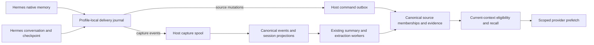

# Hermes memory integration

This document covers the Hermes provider, the local host agent, and canonical
Backplane Memory. The supported upstream contract is Hermes commit
`bac34e9e9946c9c6a9ce7ce64efadd47f8fa375b`. Installation and live verification are
separate from changing the packaged source.

The combined source at `main@eb35ecfc` passed the unchanged normal 14-gate live
scenario on 2026-10-26: exit 0 in 48.3 seconds. The contracts below describe the
implementation boundary. Verification, CI, publication and operator installation
are separate evidence surfaces; this document does not establish release or
production deployment.

## Ownership and data flow

Native curated memory and conversation evidence use different paths. Native
`MEMORY.md`/`USER.md` changes maintain independently withdrawable source support.
Conversation messages enter the existing capture, session projection, summary,
and extraction pipeline. A captured assistant statement is not a user-confirmed
fact.



The Python journal stores delivery state and source identity mappings, not a
second canonical memory store. The host provides durable provisional acceptance;
Backplane remains the canonical authority. Cwd, repository, URL agent ID,
installation ID, and profile labels are provenance or selectors. They cannot
grant access or redefine a host-authorized partition.

## Source identity and ordering

A native source namespace is the authorized partition plus authenticated host,
integration, installation UUID, profile ID, and target (`memory` or `user`). An
adapter entry UUID identifies one entry within that namespace. Session IDs do
not participate in entry identity: edits in a later session keep the entry and
record the new session as revision provenance.

Three identities have distinct purposes:

| Identity | Meaning |
| --- | --- |
| `entry_id` | Durable native-entry mapping across edits |
| `event_id` | One immutable delivery, replayed without changing its payload |
| `canonical_id` | The served memory, potentially supported by several sources |

The adapter assigns a durable increasing sequence per source target. This is
`source_revision`; it is different from the canonical edge `revision`. A stale
mutation cannot overwrite a newer head or resurrect a withdrawn entry. Event
replay returns the saved receipt. Reusing its event ID with changed immutable
data produces a conflict without partial mutation.

Pinned Hermes stores native entries separated by `\n§\n`, with exact-content
deduplication, per-target locks and atomic file replacement. It does not store
entry UUIDs or revisions. The adapter maintains those mappings locally. Complete
`metadata.previous_content` may identify an unambiguous existing mapping; lookup
substrings, semantic similarity and content hashes are not entry identities.

Several native operations may share `tool_call_id`. Callback arrival can also
lag a later native write. The adapter durably records the observation and
converges against the current strictly read, locked target snapshot. A duplicate
native add without a source change does not manufacture another source revision.
The guarantee is immutable delivery and deterministic source convergence, not
reconstruction of callback occurrence IDs that Hermes never supplies.

Strict file reads bypass the manager's callback-egress filtering. Before wire
payloads are prepared, native snapshot contents and provenance must pass the
supported public `agent.memory_manager.redact_for_egress` API. Unavailable
redaction defers delivery; its failure sentinel is not memory content. Raw
identity mappings remain local. Distinct entries that redact to the same text
retain distinct source identities, and a redacted previous value is usable only
when its mapping is unambiguous.

Remember, forget, source mutation and reconciliation acquire the shared source
partition advisory lock and existing memory-row locks in ascending UUID order
before changing a target. Relation endpoint locking uses the same row order.
This prevents a forget operation holding the higher endpoint while its support
refresh waits for the lower endpoint held by candidate creation. Nested source
and remember transactions retain their locks until the outer commit. Partition
writers serialize earlier and hold refresh locks longer; throughput has not
been benchmarked.

## Versioned source API

Source operations are local transport methods, not model-facing housekeeping
tools:

```text
POST /memory/:agent_id/call/source_capabilities
POST /memory/:agent_id/call/source_mutate
POST /memory/:agent_id/call/source_reconcile
POST /memory/:agent_id/call/source_status
```

`memory_sources.v1` is negotiated separately within the existing
`memory_commands.v2` delivery protocol. An older peer returns an explicit
unsupported-capability result. Replacement and removal must never degrade to
append-only `remember` calls. Source writes require both existing `remember` and
`forget` grants under the same authority binding. Generic `remember` retains its
immutable request-idempotency contract.

A mutation has this shape; optional provenance is omitted when unavailable:

```json
{
  "protocol": "memory_sources.v1",
  "source": {
    "integration": "hermes",
    "installation_id": "<installation UUID>",
    "profile_id": "<profile ID>",
    "target": "memory"
  },
  "entry_id": "<entry UUID>",
  "event_id": "<immutable event UUID>",
  "revision": 17,
  "operation": "upsert",
  "content": "<complete native entry>",
  "type": "semantic",
  "occurred_at": "<original ISO8601 timestamp>",
  "provenance": {"session_id": "<actual session>"}
}
```

`withdraw` omits content. Provenance supports actual parent session, message and
tool occurrence references, author/role, write origin, execution context and
repository information. The optional `memory_access_id` selects an existing
authorized access. Caller-supplied host/client/partition ownership is rejected.
Queued work retains its original authority binding; a binding rejection is
terminal rather than an instruction to rebind and replay.

Receipts distinguish `pending`, `committed`, and `rejected`, with a separate
outcome (`applied`, `unchanged`, `stale`, or `suppressed`). They include the event
and command IDs, source revision, canonical ID/edge revision when known, and
`authority`/`consistency`. HTTP acceptance is not canonical commitment.
`source_status` accepts the source identity, event ID and optional access
selector. Capability reporting separates host-local support from actual
canonical negotiation/readiness.

## Reconciliation, withdrawal and forgetting

`source_reconcile` stages a bounded immutable manifest through `begin`, `page`,
`commit`, and `abort`. Begin records a reconciliation UUID, source fence revision,
page/entry counts and snapshot hash. Each page records its index, hash, and full
entries. Hashes are lowercase SHA256 over compact UTF-8 JSON with sorted object
keys; a page hashes its entries array and the snapshot hashes the flattened
page-ordered entries. Replay preserves the exact IDs and data.

Staging does not change effective memberships. Commit requires every page and a
complete successfully read source snapshot. At fence R it updates only heads at
or below R, preserving later live writes; unchanged entries retain their evidence.
Absence withdraws covered heads, and a reconciliation floor rejects delayed old
adds that were not previously known. Missing files, read/permission errors,
undecodable input and partial snapshots never imply an empty source. A
successfully read empty file can establish an empty target.

Withdrawal removes only that source's contribution. Identical independently
supported content remains eligible. If required support disappears, current
reads suppress the unsupported memory and its affected derived outputs before
background reprocessing finishes. Historical mutations and evidence remain
inspectable.

Global `forget` is a separate intentional operation. Existing tombstones and
derivation protections remain authoritative; source reconciliation is not
permission to undo forgetting. Rollback must preserve these suppressions.

## Capture, sessions and compression checkpoints

The Hermes adapter uses:

```text
POST /capture/v1/hooks/hermes/session-start
POST /capture/v1/hooks/hermes/message
POST /capture/v1/hooks/hermes/session-end
POST /capture/v1/hooks/hermes/pre-compress
POST /capture/v1/status
```

Capture input declares `hermes_capture.v1`, immutable event UUID, journal source
sequence, occurrence/capture timestamps, session ID, installation/profile, and
available message content, role, author, occurrence references and source
provenance. The host derives trusted ownership. Canonical stream allocation is
separate from the adapter source sequence.

Capture retains the existing host-private/default partition binding. It does
not accept a `memory_access_id` override. Source mutation can use a granted
selected shared access, but automatic capture/checkpoints refuse a selector
different from the reported default capture binding. This prevents conversations
intended for a selected access from silently entering the host's private
partition. An explicit selector equal to the default is compatible. An
incompatible or disabled capture path cannot report a successful v2 checkpoint.

Pinned Hermes persists `message_uid`, absorbed message UIDs and tool-occurrence
UIDs when durable message storage is enabled. These identities deduplicate
overlapping turn/checkpoint snapshots while preserving repeated text from
different occurrences. Provider `tool_call_id` alone is insufficient. Inputs
without durable UIDs require explicit compatibility behavior; content equality
cannot prove occurrence identity.

The accumulated `messages` argument is current context, not a promise of complete
historical archival. Missing messages do not establish withdrawal. Session-switch
callbacks supply session/parent/reset/rewound information but no authoritative
rewind cursor or replacement transcript. They change subsequent attribution and
invalidate scoped cache entries without inventing historical deletions.
Callback-supplied session IDs take precedence for delayed background work.

Checkpoint API v2 advertises
`on_pre_compress(messages, *, require_checkpoint=False)`. Every exception-free
return counts as success to Hermes, so evidence and mappings must be durably
journaled before return; persistence failures must raise. Return text supplies
references and never changes the caller's messages. Local journal commitment is
not a canonical acknowledgment. With Hermes's `compression.checkpoint_required`
enabled, a persistence exception prevents lossy compression.

Current v2 normalizes direct user/assistant evidence and preserves available
identities. It excludes system/tool/summary rows and strips assistant tool calls
while retaining prose. This is not an archive of the entire original transcript.
Supported-size evidence is retained in full; any excerpt must carry original
length/hash, truncation/coverage and a truthful source reference. Old truncated
turns cannot be reconstructed without originals.

## Delivery, current context and trust

The bounded journal worker retains immutable deliveries through process exit,
host outages and lost acknowledgments. Retryable transport failures use bounded
backoff; terminal authority/validation failures remain rejected for inspection.
HTTP uses a 20-second socket timeout; asynchronous prefetch still consumes its
cache promptly. Shutdown drains for up to two seconds and joins for up to three.
An in-flight worker retains its journal until finalization; worker and caller
coordinate final closure under the journal lock. The worker stops before another
queued phase after observing shutdown. Restart recovery does not depend on
shutdown completing. Observable
states distinguish local pending, host accepted, canonical committed and rejected.
Diagnostics expose safe codes/identities, not memory bodies or credentials.
Command sync checks both the provider channel and the Access-selected channel
before claiming a durable command. A known-dead channel is offline and consumes
no attempt; a channel that fails during an actual push follows the normal retry
budget. Reconnect retains the original command payload, digest and identity.

Automatic context shares one eligibility policy across canonical reads, edge
mirrors, provisional overlays and provider caches. Deleted, expired, archived,
superseded, withdrawn and explicitly forgotten contributions are excluded. Pending
corrections suppress older source content before canonical acknowledgment;
insufficient offline support metadata requires conservative suppression.
Authorization or validation rejection cannot trigger local fallback.

Durable native remove/replace callback acceptance also invalidates the provider
cache before a source snapshot can be read. If that snapshot is unavailable or
undecodable, pending callbacks suppress affected local installation/profile/target
contributions in cached and fresh automatic context, including after a provider
restart. This conservatively suppresses the target while entry identity is
unresolved; independently supported contributions and other profiles remain
eligible. Failed reads do not change canonical source heads or imply withdrawal.
A later complete snapshot reconciles the callback and refreshes eligibility even
when the source content is unchanged.

New canonical candidates start unpublished (`effective_support=false`) until the
existing support projection has attached the request and real input evidence.
Source mutations wait for their source membership too. This prevents an initial
edge payload from claiming independent support before evidence exists, allocating
an extra revision, or producing an oversized-item tombstone for an entry that was
never published. Migration `20261024000004` makes old-row edge eligibility respect
that unpublished state. A supported entry's later withdrawal still emits its
normal tombstone.

New source/derived writes retain request traceability without inventing support:
their request evidence is `derives` with score `0.0`, and the request keeps its
actual origin and `independent_support=false`. Mutation, summary and event roots
remain the governing evidence. This change does not backfill historical request
receipts or infer missing legacy source identities.

New episodic extraction uses the internal `source_fact.v1` contract. It loads the
summary's complete, current original events, verifies their partition/session
membership, and excludes superseded message revisions. Missing, truncated or
oversized evidence fails closed. The configured model is pinned for two separate
requests per attempt: structured fact proposals and an independent semantic
assessment. Both requests retain original evidence separately from system policy
and request strict JSON-schema output. Existing worker retry limits still apply.

The first response must classify every bounded unit exactly once for durability,
self-contained meaning and currentness. Only units with all three explicitly
supported decisions may have proposals, with exactly one proposal per selected
unit. Missing/duplicate/extra decisions, mismatched units, missing selected
proposals or proposals for uncertain/unsupported units reject the entire result.
The server does not prune rejected candidates after validation, repair fields or
make a third model call. All returned proposals still undergo deterministic source
checks and the independent full-sequence assessment.

The `verbatim_source_unit.v1` extraction policy constrains statements to an enum
of complete retained user/tool text units. Units end at a terminal run of
`. ! ? 。 ！ ？`, including trailing quote/bracket closers, followed by whitespace
or the end of the event. Commas, semicolons, colons and line breaks alone do not
split units. Without a matching boundary the whole event is a unit. Only outer
whitespace is excluded; punctuation and original first-person wording remain.
These boundaries are mechanical spans, not proof of semantic completeness.

A proposal separates subject, property, value and semantic scope. Its statement
must equal one entire unit byte for byte. Entity/property/value/explicit-scope
text must occur in that same unit, and all their references must use its citation.
A speaker subject identifies the recorded user role. Extra citations can retain
correction evidence, but cannot supply missing assertion fields or omitted scope.
The server never paraphrases, joins units or repairs malformed proposals. Each
field references that fact's own zero-based citation list. The server binds unique
exact event quotes to retained-text hashes and
half-open UTF-8 byte spans; supplied stale or forged coordinates are rejected.
Speaker claims require recorded user evidence, and correction links require an
earlier assertion in the same stream plus a later user citation. An incidental
source identifier does not establish semantic scope.

The assessor must explicitly support subject attribution, property/value
entailment, scope, current corrections, durability, statement equivalence and a
self-contained assertion for every candidate. The latter requires all necessary
conditions, negation, quantifiers and surrounding qualifications to be preserved;
uncertain abbreviations, quoted punctuation and cross-unit dependencies abstain.
Missing, malformed, uncertain or unsupported verdicts reject the
whole extraction before publication. Empty extraction requires its own affirmative
assessment. Rejections remain visible through existing failed/dead-letter
processing states. Source evidence is checked again under the existing locks
before atomic persistence, and the exact assessed statement is stored with its
source contract and pinned assessment model.

These checks preserve existing derived/candidate trust and summary governance;
they do not manufacture independent support or user confirmation. Exact citations
and valid JSON do not prove entailment. The two requests use the same configured
model, so semantic mistakes about completeness or currentness can correlate;
precision is favored over recall. Verbatim publication prevents invented wording
and dropping qualifiers inside a unit; it does not prove independence from
surrounding units. Nonunique repeated quotes, cross-message synthesis and
assertions that cannot stand alone may be omitted.

Limits are explicit: at most 128 units and 32 proposals, at most 2,000 UTF-8 bytes per unit,
65,536 total unit bytes and 65,536 encoded bundle bytes; the complete JSON model
request, including the statement enum, must fit 100,000 bytes. Oversized input is
rejected observably rather than truncated or partially covered.

The legacy `extract_facts/1` result remains available to existing callers, but
cannot bypass the episodic worker's new contract. Completed historical processing
is not automatically replayed, and existing memories are not retroactively marked
as validated.

Relevance rejection uses lexical evidence or calibrated raw semantic/reranker
scores tied to the configured model, not rank-fusion scores as probabilities.
Unknown calibration falls back to supported lexical matches, and unrelated
queries may return zero. Whole entries are packed with labels/references inside a
final rendering budget; arbitrary character slices are not a memory policy.
Raw evidence, candidate inferences and established facts retain distinct trust
labels. An assistant write or request receipt alone is not user confirmation.

Parallel recall channels may straddle a bookkeeping or embedding update. Fusion
coalesces otherwise identical candidates when only their integer context revision
differs, keeping the newest revision. Content, partition, evidence, trust,
support, source references and every other candidate field must still match
exactly; substantive conflicts continue to fail closed.

The existing Memory configuration surface exposes the canonical calibration:

| Setting | Default | Meaning |
|---|---|---|
| `memory.recall_relevance_vector_model` | unset | Exact embedding model whose raw cosine cutoff was calibrated |
| `memory.recall_relevance_vector_min` | `1.0` | Minimum raw cosine, in `-1..1`; inactive without a calibrated model |
| `memory.recall_relevance_reranker_model` | unset | Literal `provider/raw_model` route whose relevance cutoff was calibrated |
| `memory.recall_relevance_reranker_min` | `1.0` | Minimum raw reranker score, in `0..1`; inactive without a calibrated route |

Model selectors and cutoffs must be calibrated together for the actual retrieval
workload. Retargetable reranker aliases cannot establish model identity. Missing
calibration, a changed model, or unavailable semantic providers leaves lexical
matches eligible; a calibrated weak reranker result rejects semantic-only
candidates. The synthetic cosine measurements below are diagnostic examples,
not an operator calibration.

Admin uses the embedding registry for both `memory.embed_model` and the calibrated
vector-model selector, including their route-readiness checks. Processing and
reranker selectors use the LLM registry. A configured unavailable route remains
visible and marked unavailable.

Canonical `memory.recall_token_budget` defaults to 4096. An explicit request
budget is supported by both recall paths, and the host applies the final budget
again after canonical/provisional merging. The provider's separate
`context_token_budget` defaults to 1200 and includes all rendered labels,
identities, revisions and separators. UTF-8 byte counts conservatively bound
byte-tokenizer tokens; oversized entries are skipped whole rather than sliced.

`is_available` checks local configuration/dependencies only.
`system_prompt_block` contains static instructions. `queue_prefetch` fills a
bounded cache consumed by `prefetch`; keys include binding/profile/session/query
and policy/freshness. Corrections, withdrawal, session changes and revocation
invalidate applicable entries. Offline freshness is bounded and cannot reveal
remote changes that have not reached the host.

## Rollout and operational limits

Roll out canonical migrations/capabilities, then the host, then the packaged
provider. Follow [the Memory release gates](../deploy/memory-v2-release.md).
Installation must explicitly update the user's Hermes plugin; a changed
repository or packaged archive does not establish that an installed plugin is
running the new code.

Legacy import/reconciliation must default to dry-run, page reliable Hermes
provenance only, retain original IDs, mark known excerpts, report ambiguity and
save a resumable cursor. Do not guess native identities or destructively replay
real operator data during development. Operator-controlled application is a
separate rollout action.

Disabling the provider stops new capture while preserving its journal and source
suppression history. Do not delete those files as an outage remedy. Do not
down-migrate the source tables or roll back to a reader that ignores effective
support after withdrawals have been applied; it can expose obsolete content.

## Verification and release evidence

### Current local evidence

The final combined source at `main@eb35ecfc` passed the unchanged normal live
scenario on 2026-10-26: **14 of 14 gates, exit 0 in 48.3 seconds**. The run used
the original fixture, configured `openai/gpt-4.1-mini`, frozen oracle and normal
harness, without external diagnostic instrumentation. Its evidence tier is
`owned_fixture_actual_http_websocket_committed_repo_async_styx`;
`boundary_diagnosis_only=false`, `synthetic_semantic_diagnostic_only=false` and
`production_installation_verified=false`.

The run verified authenticated HTTP/WebSocket capture; native replacement,
withdrawal, independent support, replay and conflict; current-context relevance,
trust and whole-entry budgets; outage/provider restart and full owned host restart;
canonical capture/projection; real asynchronous summary/extraction and embedding;
checkpoint refusal/retry; intentional global forget; and complete final fixture
state. The final fixture had two current records, including one governed
conversation memory from two derived requests retaining the user's corrected
preference without promoting the assistant guess.
Both profiles finished with no local-pending, host-accepted, rejected or
pending-reconciliation deliveries.

| Evidence surface | Observed result | Boundary |
|---|---|---|
| Final combined-source normal live scenario | 14/14 gates, exit 0; real extraction, embedding and asynchronous processing passed | Directly exercises `eb35ecfc` with the approved dependencies; isolated fixture, no production installation claim |
| Final owning BEAM selection | 101 tests, 0 failures; seed `97720` | Includes mixed-batch rejection without publication, source-unit bounds, ordered evidence/nonempty request preservation and production deduplication/order |
| Parent Python provider/runtime rerun | 81 tests, 0 failures, with `ResourceWarning` treated as an error | Source/provider/runtime compatibility |
| Unchanged OpenClaw suite | Earlier 5/5 Node checks passed | Compatibility evidence; separate from Hermes live settlement |
| Frozen semantic-oracle suite | 74 tests passed | Validates the oracle; does not substitute for the live scenario |
| A14 static checks | Scoped formatting, warnings-as-errors compilation and strict Credo passed | Owning changed files; separate from repository-wide and CI results |
| Owned resource cleanup | All four final live cleanup checks true; independent inventory found zero owned databases, fixture directories or marker-bearing processes | Earlier inventory of seven owned runs also found zero resources; only task-owned resources checked |

Final live evidence is in `/tmp/hermes-parent-final-normal-live.log` and
`/tmp/hermes-parent-final-normal-live-results.json`. Earlier A14 also passed the
normal 14-gate scenario and supplies the focused/static evidence above; its logs
are `/tmp/hermes-live-astra14-full.log`, `/tmp/hermes-live-astra14-focused.log`,
`/tmp/hermes-parent-a14-python.log` and
`/tmp/hermes-live-astra14-cleanup-verified.log`. These temporary paths identify
session evidence, not published release artifacts. The five frozen input files
and approved dependency lockfile remained unchanged.

### Integrated checkpoint

The integrated source checkpoint is `main` at `eb35ecfc`, committed and pushed.
It includes the approved 18-entry dependency refresh: eight DuskMoon bundler
packages at `10.0.6`, eight HTTP-stack packages at `0.21.17`, `ex_turso` at
`3.1.8` with force-build verification, and `rustler_precompiled` at `0.10.1`.
`phoenix_duskmoon` remains at `10.0.11`. The approved `mix.lock` SHA256 is
`9d1cc4d91df8ed792429e324ce6edac6296f7f8fdbcbfe9faf99ee4dcfe5469a`.

| Integrated evidence surface | Observed result | Boundary |
|---|---|---|
| Dependency compatibility selection | 125 tests, 0 failures across MCP Protocol, Relayixir, Admin and Host Agent | Scoped consumer checks, not every dependency's upstream suite |
| AI media compatibility | 18 tests, 0 failures | Separate from Agent Runtime execution |
| Development compilation | `mix compile --warnings-as-errors`, exit 0 | Development environment |
| Isolated development Dialyzer | Exit 0 in 266.6 seconds; passed with existing warning/ignore rules | Fresh canonical build and core/project PLTs; separate from Linux CI |
| Production assets | `mix assets.deploy`, exit 0; public and admin profiles built and digested | Asset assembly, not release assembly or deployment |
| Fresh integrated Memory suite, first run | 1,474 tests, 2 failures; seed `614032` | Qualification performance and Mix-task tests failed; retention assertions passed |
| Fresh integrated Memory suite, return-traced diagnostic | 1,474 tests, 0 failures; same seed; 227.1 seconds, exit 0 | Instrumented full-suite evidence; original qualification failure remains unreproduced |
| Final standard Memory suite after the comparator regression | 1,475 tests, 0 failures; seed `614032`; 250.4 seconds, exit 0 | Fresh owned database; no tracing, diagnostic mode or test exclusions |

The first run's performance test failed `assert report.passed`, but did not print
its report. The separate CI-smoke Mix-task report accepted and persisted
1,900 of 2,000 requested events; 100 returned retryable `storage_error`, with
19 of 20 durable projection frontiers/jobs. Integrity and ingest-throughput gates
failed despite approximately 1,442 events/second exceeding the 50/second speed
threshold: completeness and projection work are also required. The original
storage exception and its cause were not established.

The same-seed diagnostic captured qualification returns without a production
source repair. Its performance and CI reports accepted and persisted all
2,000 measured events and passed every gate. That pass does not identify or fix
the first failure. These are sandbox-suite measurements, not the separate
real-pool release qualification. The subsequent uninstrumented Linux CI smoke
report at `eb35ecfc` also accepted and persisted 2,000 of 2,000 events with every
qualification gate passing. All fresh databases created for these integrated
runs were dropped. Session evidence is in
`/tmp/hermes-parent-integrated-memory-full.log`,
`/tmp/hermes-parent-qualification-full-diag-tests.log` and
`/tmp/hermes-parent-qualification-full-diagnostic.jsonl`; execution and cleanup
results are in `/tmp/hermes-parent-qualification-full-diagnostic-results.json`.

The local Agent Runtime selection completed 14 tests with eight failures on
macOS. Seven reported unavailable `code_mode`; one reported an exact
admission-authority mismatch. Read-only diagnosis confirmed that Code Mode
requires Linux process-lifecycle evidence (`/proc` and `kill`) and Deno, while
the host was Darwin without `/proc/self/stat` or Deno in `PATH`. Empty Code Mode
contracts also explain the fixture's authority mismatch: its grants still name
`exec` and `wait`. Installing Deno alone cannot satisfy the Linux gate. The
dedicated Linux [Agent Runtime run 40210083122](https://github.com/gsmlg-opt/backplane/actions/runs/40210083122)
passed at upstream `3ae1dff0`; the runtime sources and its workflow are unchanged
in `eb35ecfc`. That inherited result is distinct from exact-head runtime
verification, and the local runtime selection is not recorded as passing.

Development Dialyzer completed successfully with a fresh canonical build and
isolated core/project PLTs, retaining the existing analysis and ignore rules.
Its summary was `Total errors: 118, Skipped: 118, Unnecessary Skips: 51`, followed
by `passed successfully`; these are 118 findings covered by existing filters,
not 118 unhandled errors. Results are in
`/tmp/hermes-parent-isolated-dialyzer-results.json` and its referenced log. An
earlier test-env run's three warnings do not establish the development CI result.
The first dev run failed PLT preparation on missing consolidated BEAM files before
emitting 8,587 errors; that invalid analysis is not accepted as source diagnoses.
The original integrated command results remain recorded in
`/tmp/hermes-parent-integrated-checks.json`.

At the `eb35ecfc` runtime-source checkpoint,
[CI run 40213275784](https://github.com/gsmlg-opt/backplane/actions/runs/40213275784)
passed all five checks. The Memory job in
[Test run 40213275775](https://github.com/gsmlg-opt/backplane/actions/runs/40213275775)
completed 1,474 tests with one failure and five existing qualification-runtime
exclusions. Its failure was a different, reproducible test-comparator defect:
the database correctly returned evidence at `16:55:03.963980` before
`16:55:04.007552`, while default Elixir struct ordering reversed the timestamps.
The assertion now compares Unix microseconds and UUIDs. A fixed second-boundary
and equal-time UUID fixture failed the old comparator and passed the correction;
the 26-test evidence file passed without sleeps, evidence mutation or weakened
count assertions. Runtime ordering code was unchanged. The corresponding
RED/GREEN and owned-database cleanup records are in
`/tmp/hermes-chrono-results.json`.

The final standard full-suite run then passed all 1,475 tests, including the
qualification runtime tests, without diagnostic tracing or exclusions. Its
command was `MIX_ENV=test mix test apps/backplane_memory/test --seed 614032`
with a fresh owned `MIX_TEST_PARTITION`; the database was dropped afterward.
The command and cleanup records are in
`/tmp/hermes-parent-final-memory-standard-results.json`.

Delivery must independently verify the final commit's CI/Test workflows and the
immutable SHA selected by the existing release workflow. Published artifacts,
package registries and operator installation require their own receipts; local
checks do not establish them.

### Reproducing the checks

Run the standalone scenario with an already available PostgreSQL/pgvector service
and a real Hermes interpreter. `HERMES_PYTHON` can select an interpreter when the
installed-runtime discovery does not find one. `OPENROUTER_API_KEY` must already
be provided through the environment for the real model/embedding gates; the
Python peer never receives that credential.

```sh
MIX_ENV=test BACKPLANE_MEMORY_QUALIFICATION_REAL_POOL=1 \
  MIX_TEST_PARTITION="_hermeslive_$(openssl rand -hex 8)" \
  mix run --no-start test/hermes_memory_live_acceptance.exs
```

The runner refuses an existing database or fixture directory, binds temporary
loopback ports and cleans up its owned resources. Each failed or blocked gate
keeps the overall run unsuccessful. The checkpoint fault gate uses the actual
Hermes caller/manager and an owned SQLite persistence failure. Its retry verifies
dispatch to a sentinel compressor, not completion of summary compression.

Provider, compatibility and oracle checks can be run separately:

```sh
PYTHONWARNINGS=error::ResourceWarning PYTHONDONTWRITEBYTECODE=1 \
  python3 -B -m unittest discover \
  -s integrations/memory/tests -p 'test_hermes*.py' -v
node --test integrations/memory/tests/test_openclaw.mjs
MIX_ENV=test mix run --no-start test/hermes_memory_live_oracle_test.exs
```

The recorded 101-test owning selection was:

```sh
env -u MIX_TEST_PARTITION -u BACKPLANE_MEMORY_QUALIFICATION_REAL_POOL \
  MIX_ENV=test mix test \
  apps/backplane_memory/test/backplane/memory/llm_test.exs \
  apps/backplane_memory/test/backplane/memory/fact_extraction_test.exs \
  apps/backplane_memory/test/backplane/memory/workers/episodic_worker_test.exs \
  apps/backplane_memory/test/backplane/memory/workers/hermes_pipeline_test.exs \
  apps/backplane_memory/test/backplane/memory/workers/stage_processing_test.exs \
  apps/backplane_memory/test/backplane/memory/memories/verification_test.exs
```

Release qualification runs the source lifecycle regressions in
`.github/workflows/release.yml` before publication; packaged-provider tests run on
assembled host artifacts. Repository/release contract checks are separate commands:

```sh
MIX_ENV=test mix run --no-start test/release_config_test.exs
MIX_ENV=test mix run --no-start test/ci_workflow_test.exs
```

### Material earlier failures and the resulting safeguards

Earlier results explain the implementation; they are not the current live
qualification result:

- **Free paraphrase and correlated model errors.** Earlier normal runs reached
  13/14 gates but attached an incidental source identifier as the user's preference
  scope (`derived_current_user_correction_missing`). Final transport inspection
  showed that the configured model, system policy and retained evidence arrived
  intact. Prompt-only changes did not resolve the error. Structured proposals
  and a separate assessment then exposed a correlated same-model error: a
  diagnostic approved an invented subject and failed extraction plus final state
  (12/14 gates). Exact source-unit publication, explicit per-unit selection and
  independent full-sequence assessment now replace free paraphrase publication.
  Valid JSON and positive model verdicts alone cannot authorize invented wording.
- **Recall revision races and provider deadlines.** Concurrent FTS/vector reads
  returned HTTP 400 `retrieval_failed` when only timestamp-derived context
  revisions differed. The regression failed before the narrow fusion correction
  and passed afterward. A separate real HTTP/WebSocket diagnostic with real
  embeddings returned corrected context in three HTTP 200 requests (1.895, 3.642
  and 2.968 seconds), using an explicit 20-second diagnostic deadline. The
  provider's former two-second deadline was insufficient; it now uses 20 seconds
  and synchronized worker/journal closure. Those diagnostic timings are not a
  latency guarantee or relevance calibration.
- **Outage admission, observer freshness and cleanup.** A prior full run exhausted
  command retries after admitting a cached channel PID that had exited. Cached
  negotiation flags also falsely indicated recovery readiness. Channel liveness
  now gates claiming, and readiness requires a fresh live channel/socket/generation
  and connectivity. The observer requires completed, unexpired results from the
  current cache generation/session/binding, including valid empty results. Earlier
  cleanup exceptions and stale-cache diagnostics were reproduced and corrected;
  their exact owned resources were independently removed. Controlled observer
  tests and 278 host regressions supported these repairs; A14 separately verifies
  actual outage/restart settlement and cleanup.
- **Source lock ordering.** An ordered candidate/forget race reproduced PostgreSQL
  `40P01` before the partition-lock/ordered-memory-lock correction. The related
  relations/source/remember/edge selection then passed 83 tests and the final
  concurrency file passed three tests. These checks address locking, separately
  from model semantics.
- **Evidence lineage and load-order assumptions.** An early focused run had
  198 tests with two failures: direct-event versus summary evidence, and four
  expected evidence rows versus two retained rows for derived writes. A later
  94-test compatibility selection found two file-compression provenance failures
  from the same missing request evidence. An isolated spool run also exposed
  `String.to_existing_atom/1` fingerprint dependence on atom load order. Truthful
  request receipts, actual summary/event lineage and compile-time fingerprint
  keys addressed these failures. The subsequent combined backend selection passed
  536 tests (contract 4, Memory 330, Host Agent 163, API 39); configuration/current
  reads passed 25 tests, release configuration 31 and workflow contracts eight.
  Migration `20261024000004` was applied only to test databases.

Earlier supporting evidence also includes the Admin embedding-calibration registry
regression (four tests) and full Admin CI suite (486 tests). CI at `4053ada7`
passed compilation, formatting, Dialyzer and workflow-contract checks; a SQL-literal
Credo finding was subsequently fixed without changing the evaluated query.
These historical checks do not qualify a later commit or artifact automatically.

**Historical retention baseline:** the two global activity-retention count assertions
failed with `3 != 0` before Hermes at `f36d09c8`
([run 40076035113](https://github.com/gsmlg-opt/backplane/actions/runs/40076035113))
and recurred on committed `c4ce197d`
([run 40203194254](https://github.com/gsmlg-opt/backplane/actions/runs/40203194254)).
The latter Memory job completed 1,448 tests, two failures and five exclusions.
The retention worker and its tests were unchanged between those commits; the
exact origin of the remaining rows was not proven by those runs. Upstream
`b4f74387` subsequently added committed summary-activity fixture cleanup and is
integrated in `eb35ecfc`. The retention assertions pass in both fresh integrated
Memory suites above. The historical failures are retained as evidence, not a
current waiver; no Hermes retention workaround was applied.

### Evidence limits and operator actions

The live result qualifies this isolated scenario. It does not prove arbitrary
semantic entailment: selection and assessment use the same configured model and
can make correlated errors. Mechanical source spans prevent invented publication
bytes and intra-unit qualifier slicing, but do not establish independence from
surrounding context. Conservative rejection intentionally reduces recall.

An earlier direct-client OpenRouter probe returned four example facts and three
2,560-dimensional embeddings. Example related/unrelated cosine values of 0.4314
and 0.0427 were diagnostics only; they establish neither calibrated thresholds
nor gateway/host lifecycle behavior. Use the workload-specific calibration
requirements above.

The combined-source live pass and completed integrated checks above supplement
the earlier A14 evidence. Exact delivery CI, Linux runtime verification,
published-artifact parity and production installation each have separate
evidence boundaries. Canonical Agent Note revisions 3 and 4
recorded earlier contracts and acceptance boundaries; their historical verification
status must be reconciled against the current source and evidence rather than
treated as a release record.

Operators still need to follow the existing release gates, deploy canonical
capabilities/migrations and the host, explicitly upgrade the installed Hermes
plugin, and perform any selected legacy dry-run/reconciliation/import. Production
bulk replay, destructive historical cleanup, credential changes and installed
plugin upgrades are not established by these development checks. Preserve the
journal and source suppression state when disabling or recovering the provider;
follow the rollout and rollback limits above.
