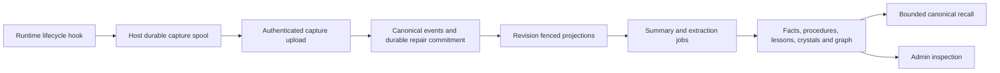
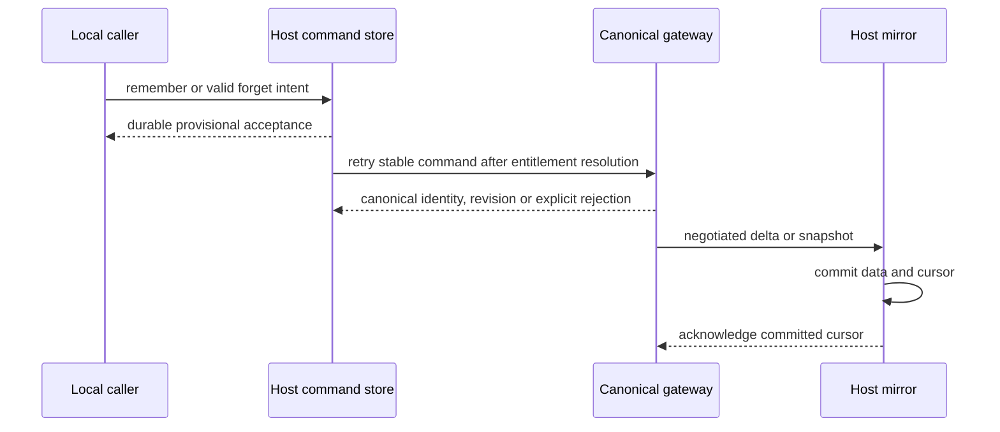

# Local Memory implementation and verification boundaries

Delivery is incomplete. This document explains accepted ownership and the
verified implementation slices; required CI is red and no release is claimed.
See [the acceptance report](local-e2e-acceptance.md) for L01–L18.

## Authority and transport

Backplane owns canonical spaces, authenticated entitlement, event history,
long-term memory, revisions and governance. A host owns three separate local
stores: a durable command outbox, durable capture spool, and bounded mirror.
The mirror supplies transport-only fallback after exact partition resolution;
it cannot turn an authorization, revocation or protocol error into cached success.
Slots remain device-local. Facets follow the canonical shared contract.

Permanent rejection now has focused source and actual local credential-revocation
evidence. The gateway revalidates assigned credentials on Memory/MCP requests,
pushes and registration; the host retains permanent denial until authenticated
recovery. Published phoenix_socket_client0.8.8 supplies `connection_info/1` with
attempt identity/status/error independently of telemetry. Connector checks a
settled snapshot again before accepting it, classifies HTTP401/403 as unauthorized,
and retires failed sockets after asynchronous disconnect settles. MemoryProxy
prevents an old connector rejection from poisoning a replaced connection, and
MemoryFacade checks retained denial before provisional remember/forget. The
upstream duplicate-registration fix replaces the obsolete local initializer;
channel children remain temporary so Worker owns rejoin and consumer refresh.

Routing13 passed177 scoped regressions. The actual populated-cache probe passed30
strict direct/MCP cases across existing/warm/cold revoked connections; recovery
proved sentinel preservation, absent denied writes and unchanged tombstones.
Cold pre-negotiation owner diagnostics are deliberately unavailable, not empty.
See the acceptance report for exact evidence and the retained failed first probe.
Temporary transport failures retain bounded-stale fallback and provisional command
admission. A new actual gateway-outage probe confirmed exact direct/MCP mirror
recall, duplicate provisional identity, automatic canonical one-copy settlement
and preservation of187 baseline records/tombstones after the socket upgrade.
Shared-host grants separate `read`, `deliver`, `remember`, and `forget` on an
exact canonical partition, as specified in the [shared-access design](shared-host-access-design.md).
Canonical authorization, Admin controls and host/channel integration are implemented;
the actual online capability matrix and positive shared recall/populated-mirror
subset passed. The accepted L13 composite now also covers independent capability
withdrawal, offline leases, cold closure and newer regrant/old-intent rejection.
See the acceptance report for exact live and deterministic evidence boundaries;
fixture alias checks do not establish an exhaustive pre-run alias-table digest.

A completed snapshot ACK differs from an intermediate chunk: canonical `advanced`
clears the cursor, so its reply requires `next_chunk_index: null` even though the
final snapshot request carries the next positive index. `progress` instead requires
the matching positive cursor. Both retain exact revision, access, partition, batch
and hash checks; malformed completion remains a permanent protocol failure.
Historical fences survive a same-version reconnect. Recovery uses an audited newer
authority version, never direct mirror or authorization-store edits.

Known transport failures use the existing strict transport classifier before
permanent-denial classification. A channel-call `noproc` or timeout therefore
preserves authority while scheduling recovery; unknown wrappers, protocol errors,
target denial and credential rejection retain their existing fencing boundaries.
After a partition is selected, failed polls retain round-robin advancement so a
closed target cannot starve another valid grant. Multiple partitions cap the actual
retry delay at the configured polling cadence while the bounded exponential
counter still grows; single-partition and preselection failures retain exponential
delays. Multiple failing partitions consequently retry more often than full global
backoff. Focused owner/syncer regressions cover these mechanisms; actual local
outage/restart qualification is recorded separately in the accepted L13 composite.

Shared commands retain an immutable target, authority version and digest through
settlement. The canonical transaction checks the real host credential and current
grant under locks, then commits the effect with a content-free receipt. A duplicate
can reconcile its own committed receipt after grant revoke, but cannot execute a
new effect or bypass credential revocation. Facets supplied to a new shared remember
are inserted inside that transaction; a reused candidate cannot gain or change
facets through remember-only authority. Failed nested transactions explicitly pass
their original reason to the outer rollback, preserving both atomicity and the
bounded public error. Tests verify unchanged record, evidence, revisions, audit and
receipts for rejected facet changes. This evidence covers the domain boundary;
the host/channel outage and restart paths are independently qualified in the L13
composite. L18 now has accepted retained-workflow evidence after ancillary
classifier recovery and strict final preservation/topology checks. The failed late-event Graph
attempt has a separate successful, explicitly operator-assisted recovery.

This is the required architecture. Normal Styx execution has produced fixture summaries, extracted memories,
lessons, crystals and graphs. Complete source support, quality and recovery gates
remain unpassed; the diagram is not evidence that every arrow is qualified.

The latest routing/outbox recovery passed229 host and109 API regressions,
including canonical-delete intents, exact pending overlays, settlement and mirror
acknowledgments. These are focused protocol/fault tests. Later real outage probes
verified durable capture, bounded-stale mirror reads and eventual settlement, but
sustained automatic recovery initially failed with repeated duplicate_join.
The additional recovery below now has passing regressions and an actual outage
plus130second sustained online recovery subset. Stalled channels, interrupted
snapshots and replay/rebuild governance remain separate gates. Never infer
canonical success from durable
provisional acceptance.

Cold local command dispatch now uses fixed command atoms, avoiding runtime atom
availability as a startup dependency. A supplied matching read scope confirms the
authenticated scope and is stripped before the domain call; foreign authority
claims remain rejected. Server channel close/error terminates the temporary
AgentChannel. Its owning Worker monitors that exact channel, ignores stale DOWN
references and reconnects through the shared provider and existing edge syncer.
The monitor behavior passes focused tests; its original competing reconnect
paths required the single-owner correction below. A separate recall-candidate constraint correction passed26 tests and
was applied to dev; actual V2 recall exposed a function referring to the wrong remember-request
table name. A forward migration repairs the applied guard; the regression now
uses the real table and tests old→new migration. Actual online traces persist
and render in the Admin UI. Actual direct/MCP exact and paraphrase recall now work: the12second finite
retrieval deadline accommodates the10second provider timeout within the30second
host budget. Query, vector filtering and trace share one pinned Settings model;
filtering precedes ranking/limit, while historical labels stay available to FTS.
The64-test recovery and actual4query/browser/model-provenance checks pass for
the retained fixture; this does not establish a broad recall benchmark.

### One owner for connection replacement

Worker, socket auto-reconnect and request-triggered MemoryProxy reconnect could
each join the host topic independently. The socket dependency also ignored a
failed local topic registration, allowing an unregistered channel to join while
replies still routed to its predecessor. This explains the reproduced duplicate
join mechanism; the exact asynchronous message behind the later redacted host
crash cannot be established from its historical log.

Worker now owns replacement. The socket does not reconnect autonomously; managed
MemoryProxy requests notify their owner and return a transport failure, allowing
the normal provisional/mirror policy to decide the response. Successful joins
refresh command/capture consumers and the existing EdgeSyncer together. Tagged
retry timers, exact channel notifications and monitors reject stale work. Failed,
replaced and orphaned owned channels retire with bounded shutdown. Owner cleanup
only clears its own registration; legacy unmanaged proxy usage retains its
existing reconnect behavior. The registration callback guard is a temporary
workaround for [phoenix_socket_client#109](https://github.com/gsmlg-dev/phoenix_socket_client/issues/109).

### Observe durable state through its owner

Turso's current local connection takes a lifetime exclusive file lock. A second
SQLite connection is therefore unsuitable for observing live command, capture
or mirror state. The bounded loopback diagnostics endpoint uses the existing
owner connections, validates the negotiated partition and returns IDs, state,
attempt counts, committed ACK metadata and active-generation metadata. It never
returns memory content, capture envelopes or configuration secrets. Independent
store reads are reserved for verified stopped-process durability checks.

Actual pending-restart acceptance now observes the same command/event and mirror
generation before shutdown, from stopped storage and after restart, followed by
ordinary exactly-once canonical settlement. Empty baseline tombstones do not
prove positive tombstone survival; interrupted snapshot qualification remains
separate. A pending forget keeps its local identity and exposes an already-known
canonical mapping. Only the later canonical ACK supplies the deletion revision.

## Verified changes

- The actual `mix agent.run` entrypoint now starts the Worker-owned connection
  path. Worker honors an explicitly supplied configuration across retries and
  publishes effective Memory policy before local HTTP starts. The 27 focused
  startup tests pass in the complete devenv environment.
- Model configuration presence now follows normalized `memory.llm_model` in
  Settings. It is distinct from provider health and successful requests.
- Graph extraction and query expansion issue bounded structured requests and
  validate the response shape. Errors remain errors. Graph relation references
  resolve to persisted node UUIDs; lexical search remains available when optional
  expansion fails. The 46 focused tests pass with a real test database and
  `Req.Test` provider responses, without a real provider claim.
- Scheduled lesson decay carries canonical space identity through enumeration,
  five-field continuation cursors, enqueue, execution and continuation.18
  focused tests pass, including exact host/client boundaries and foreign-space
  isolation. After fixing the standalone controller timezone prerequisite, actual
  Cron roots and gateway workers passed L16: complete partition, exactly one decay,
  only the old target archived and strict retention boundaries, with unchanged
  nonfixture data and service identities. No Worker.perform was used.
- Memories inventory handles unknown/deleted details, filters by source session,
  preserves filters in pagination/detail navigation, and refreshes bounded local
  reads every two seconds using one timer per connected view. Matching counts
  refresh even when the new record is outside the displayed page. Six focused
  tests pass after the nil-session detail correction. Actual browser observations
  measured a new row in2328ms and forgotten detail disappearance in2307ms, both
  without document reload. Broader cross-page behavior remains incomplete.
- The lifecycle CLI refuses process adoption and validates kernel process birth
  identity and every live group member before signals.18 synthetic tests cover
  detached groups, unrelated process preservation and stale identity refusal.
  Actual legacy-host stop exposed an exit/signaling race. The22-test Astra recovery
  handles confirmed disappearance while retaining ownership checks. A later actual
  host cycle verified all original processes exited, gateway identity was unchanged,
  and endpoints recovered. Full retained-run repeatability remains incomplete.

## Implementation awaiting validation

`memory.proxy_credential` names a vault service credential for authenticating
Memory's own requests to the local LLM resource. This is separate from upstream
provider API credentials and the host token. Both LLM and embedding requests use
that bearer when configured; an unavailable configured credential fails closed.
Embedding requests specify the existing database dimension of 2560 and reject
malformed, missing, duplicate, misindexed or incompatible vectors. Provider error
bodies are excluded from embedding error terms. Capture suppression remains in
place. These changes have meaningful red tests. The initial command launch was blocked by `Too many open files (os error 24)`; execution recovered and the bounded-input/authentication/configuration slice passed 14 focused tests. Actual gateway resource authentication subsequently passed: missing bearer401,
authenticated structured chat200 and2560-dimension embedding200. The embedding
worker pins the selected model before requesting a vector and atomically persists
the vector and model under the existing content-revision fence. A newly settled
isolated record proves the configured model label; historical vectors are not
relabeled. These results do not establish useful end-to-end recall.

## Processing and current live limits

The existing ProcessingState and source revision fences remain the processing
authority. Stage gates must govern their consumers before provider calls and at
fenced persistence. Disabled queued work reports `skipped_disabled`; previous
complete artifacts stay inspectable. A bounded resume worker reconciles eligible
missing/pending/skipped work on re-enable/model changes and periodically.

Session consolidation must enqueue the ordinary session revision chain and
return correlated progress/artifact IDs; it must not treat a session ID as a
project profile ID. Fixed 100-event windows are separate window-summary subjects
using the existing Summary storage, source links and processing state. Window
enumeration and per-window generation remain bounded and fenced. Deterministic
summaries must identify their generation mode and reason rather than imply model
enrichment. The implementation now passes 32 focused stage/repair tests and 45
adjacent extraction tests, including real ingestion of 10,001 events into 101
bounded windows. The immutable event trigger remains enabled; persisted
remediation lessons use the supported `correction` kind with their extraction
kind retained as metadata; disabled summaries explicitly remain skipped. Real
Styx/provider processing produced real artifacts. Repeated same-revision graph
retries, repeated completed windows and an ineffective graph switch were reproduced.
The108-test Astra4 correction excludes complete/failed/dead_letter revisions from
automatic reconciliation, permits explicit failed retries, deduplicates window work
and checks the actual graph gate before model calls and fenced writes. The gateway
was cold-restarted. The four original gates were restored through real browser
controls after L16 passed; normal processing resumed. Read-only sampling across two normal scheduler ticks found no new graph/window
jobs or repeated terminal attempts. Subsequent fresh-session quality and
strict-schema graph recovery passed the exercised local-dev subset described below.

The current quality repair preserves explicit empty model arrays instead of
overwriting them with fallback claims. A historical error remains source
evidence; the deterministic fallback does not infer that it is unresolved. The
model prompt distinguishes verified outcomes, accepted decisions, resolved
errors and outstanding follow-ups. Existing completed crystals retain their
immutable identities and history; a fresh captured fixture must prove quality.
Summary rendering merges observations and errors in canonical source order
(`source_sequence`, event type, event ID), matching canonical revision input.
This is source sequence order, not a wall-clock ordering guarantee when source
timestamps disagree. The captured stream is keyed by host/session, independent
of source integration/client. Graph validation retains the strict public
schema/error contract and emits only fixed rejection classifications, without
provider response values. Graph requests now use strict JSON Schema with the
existing exact keys/type/relation enums, while the local parser continues to
check cardinality, strings, uniqueness and references. Query expansion retains
its separate JSON-object contract. A schema rejection is a provider error;
there is no silent schema downgrade. A real browser Consolidate retry completed
the fresh captured revision through normal Styx/real provider, preserving the
summary, seven facts and Crystal, and a repeated completed action retained graph
IDs. Evidence: graph-retry-1792480380851501000/report.json. Fresh quality review
also verified chronological failure/recovery and the actual outstanding follow-up.
These results do not rewrite historical completed artifacts or dead-letter jobs.

Pipeline metadata derives ownership from canonical sessions and memories. The
raw `source_client_id` is provenance and cannot substitute for authenticated
`client_id`. Unknown subjects are omitted before the result limit; profile
verification uses at most 50 canonical profile candidates. The UI calls this
bounded selection “Latest verified states.” Source navigation tests use supported
capture ingestion rather than legacy events that canonical readers exclude.

## Crystal revision refresh and immutable provenance

A session Crystal has one stable processing identity and Crystal ID across source
revisions. A late canonical event may advance its current digest; this must append
new evidence without rewriting the previous summary links or remembered request
history. The original constraints required every historical summary to equal the
current revision, so a code-only refresh could not satisfy those invariants.

Forward migration20261020000003 retains append-only source links, validates exact
subject/partition for their retained history, and requires positive current
summary-v1 evidence matching the final Crystal and current projected revision.
Deferred validation checks the final stored row so pointer/revision/link changes
commit together. New source-link insertion still requires the current Crystal
revision. Rollback refuses incompatible retained history or governed parents;
it never deletes evidence to make rollback pass. Action-chain semantics remain
unchanged.

The Crystal context locks source streams, processing identity and the current
backing Memory, then fences the source before and after provider execution.
Unchanged revision returns without provider effects. Identical generated content
reuses the existing backing Memory; changed content creates a new Memory and
archives a superseded active parent atomically. The old body, content hash and
request history remain untouched. Archived policy carries forward; a tombstoned
or deleted parent refuses enrichment before the provider call. Unrelated exact
candidate collisions return an atomic error rather than fabricated content.
Active Crystal search still excludes archived/deleted backing records.

The compatible API keeps source_summary_ids and adds current_source_summary_ids
and historical_source_summary_ids. Admin labels both categories explicitly and
reads immutable historical summary sources. Actual local R2 Admin repair followed
by a fresh unchanged repair preserved the stable Crystal and all evidence while
two forgotten facts stayed absent. A targeted public projection rebuild and
separate read-only checkpoint preserved that state. Source-race/concurrency,
constraint and rollback details have focused regression evidence; the provider
did not emit the exact forgotten hash in this live run, so suppression of that
particular output is not claimed as live-observed.

## Delivery gate

Local L01–L18 are accepted at the evidence levels in the acceptance report.
A20's durable comparison reuse passed Memory1413/0 and Admin134/0, followed by
actual cold runtime loading. Task127 completed the exact16 remaining retries
through audited repair and normal gateway workers. Prior completions/sentinels,
error histories and audits remain preserved. Strict final preservation passes;
two additional normal scheduler jobs were explicitly reviewed, not silently waived.
L18 combines retained repeat/restart/browser/processing/governance evidence and
final owned-process cleanup. Eleven historical row changes are attributed additive
provenance, not byte-identical data. Original failed reports remain unchanged.
Required red CI/release gates remain unwaived. No version change or release has
occurred. The healthy fixture/provider configuration and local review stack remain
running. See the acceptance report for final commit/push and exact CI status.

## Current recovery evidence boundary

Online host forget remains a durable provisional command until canonical ACK;
the browser must display the eventual canonical state rather than infer deletion
from local acceptance. An actual nil-session explicit memory exposed an
unconditional verified Session route. Guarding unavailable Session/Replay links
preserves its detail/Audit view and valid source navigation. Six scoped tests
passed; the real open detail disappeared2307ms after host forget without URL or
document replacement, and canonical snapshot1792435138384668000 verifies the
same ID tombstoned. Offline forgetting and replay/no-resurrection remain separate
mandatory gates.

The actual stopped-gateway probe demonstrated persistence but failed recovery:
a nested reconnect/socket_timeout was not classified for mirror fallback and
Syncer attempted String.Chars conversion on a tuple, crashing the host. Operator
restart later settled the write once. Astra4 now classifies socket_timeout, bounds
tuple diagnostics and catches push-boundary channel exits. It also uses a sorted,
versioned fingerprint and verifies an immutable original outbox payload before
upgrading legacy hashes.204 focused tests passed; the original previously
conflicting request replayed successfully with the same IDs. The real outage
subset initially converged, then duplicate_join churn caused sustained offline
behavior. That unresolved lifecycle defect retains the original routing task and
its exhausted Sol2/Astra4 budget; no stable automatic recovery is claimed.

The later reconnect recovery uses a single Worker-owned connection lifecycle.
Actual gateway outage/recovery then remained online for130seconds without a
host restart. A separate connected-peer fault paused only the owned gateway
BEAM with an identity-checked20second resume watchdog. Both interfaces returned
bounded-stale results after about5seconds; writes staged during the fault
settled once after recovery. No fault remains active. This is scheduler-pause
evidence, not a network-proxy or cross-machine qualification.

## Automatic derivation after forget

A durable keyed retry already returned its original tombstone. That alone did
not prevent a new summary revision from producing the same fact under a new
worker request key. The Memory context now applies a transactional guard to
automatic episodic/procedural writes: same candidate identity, exact partition
and host/client attribution, with incoming captured-session roots wholly
covered by a forgotten candidate's source roots, bind to that tombstone.
Candidate rows are locked before the check; suppressed requests remain
idempotent and add no new support evidence. Audit labels the result suppressed.

Stable roots are host/session subjects rather than summary IDs or event subsets.
An unrelated late event therefore cannot bypass the decision by changing the
summary revision. Source partition validation is preserved. A fresh explicit
remember, an independent supporting subject, and archive semantics retain their
normal behavior. The guard adds no migration or public tool contract.

This is bounded by existing attribution: extraction attributes whole sessions,
not fact-specific causal events. Newly supporting evidence inside one governed
session cannot be distinguished precisely, and paraphrased content with another
hash is outside the same-candidate guard. Captured history and summaries remain
retained and may remain recallable. Regression coverage reproduced episodic and
procedural resurrection, then passed76focusedtests. Combined owning Memory
validation passed1324tests after fault38 additions. Actual governed-source replay
acceptance remains separate and pending.

## Exact provenance navigation

A provenance link identifies an immutable source, rather than whichever output is
current when the operator follows it. Memory Summary links now keep the selected
Memory ID and `source_summary` UUID. The owning Memory context joins that Memory,
its durable evidence, the exact Summary and the canonical projected session,
checking the complete partition and subject/session identity. A historical
summary remains readable when linked; unlinked, foreign, malformed or deleted
sources return an explicit unavailable state. The source pane displays its own
ID, input/output revision, processing version, Current/Historical status and text.

Event explorer selection is separate from its finite timeline filter inventory.
The five validated partition parameters survive filter, pagination, detail and
close navigation. An explicitly selected event must match that exact partition;
the existing trusted operator explorer without a selection remains available.
Crystal, Lesson and Memory event links retain this selection. Lesson Session
links open the exact session detail instead of the stream inventory.

Scoped domain/Admin regressions passed58 tests, formatting and dev compilation.
The actual local rendered inventory followed37 links across Session, Crystal,
Lesson and two Memory details with no lost partition, unavailable destination or
page error. It separately verified historical R1 and R2 Summary IDs/revisions;
the coordinator visually inspected the R1 source pane. Evidence:
`oct20-a/link-inventory-1792488572306793000/report.json`. The older30-link failure
and later driver-preflight failure remain unchanged. This navigation result does
not prove every open-page mutation or the still-blocked authorization scenario.

Late events retain the completed session lifecycle. Full-session enrichment waits
for `memory.event_gap_grace_seconds` (default60), then the minute StageResume cron
can resume Summary and downstream work; window processing may finish earlier.
Processing duration is distinct from the five-second UI observation budget. In
the current R3 live run, Summary/Episodic/Crystal resumed normally; invalid graph
edge references produced an honest dead letter. A supported operator retry through
normal Styx/real provider completed that same revision, adding8 nodes/18 edges.
Graph/Pipeline observations were1532/2179ms with immutable source/artifact guards.
This is operator-assisted graph recovery, not automatic first-attempt success.

Capture owner diagnostics are time-sensitive: the normal spool may compact ACK
rows after60seconds. `missing_or_compacted` conveys unavailable evidence; it does
not prove an ACK or that compaction occurred for a particular event. Observe ACK
while retained for capture qualification. A later UI-only observer can rely on
canonical source identity and retain an explicit unavailable-ACK result, without
claiming a new transport/capture pass.

Profile request validation and persisted-data quarantine have different effects.
The complete canonical tuple is still checked against project sources before
enqueue, and a foreign-project request is rejected without creating a durable
backfill issue. A rejected incoming claim is not evidence of ambiguous stored
data. Persisted profile jobs retain their issue-recording path so genuine legacy
ambiguity continues to block unsafe reads and synchronization.

Historical issues from the old enqueue path cannot identify their origin from
the row alone. A trusted operator must review the original request evidence and
call the narrow rejected-request waiver operation with an exact issue snapshot.
The domain locks the row, checks its hash and current source mismatch, refuses
persisted project work (including retired memories and terminal jobs), and
atomically records an approved waiver and repair audit. It retains issue details
and leaves unrelated blockers untouched. This repair does not merge spaces,
backfill provenance, or change public authorization. The two-file correction is
`2753065f`; focused regressions and actual local rejection/read/mirror-delta
evidence are linked from the acceptance report.

## Provenance enrichment and retained historical identity

Repeated supported remembers may reinforce an existing canonical content identity
and append automatically observed repository provenance. They preserve existing
source/evidence and authorization identity; they do not create a host selector as
an authority grant. Reconciliation121 proves the eleven historical row changes
are only `metadata.repository_sources` and `updated_at` by reconstructing both
original baseline hashes with retained old values. Full evidence-row fingerprints
and the274-memory content/lifecycle/source inventory remain preserved. This is
expected enrichment, not byte-identical row preservation; the original failed
strict comparison118 remains retained beside the field-level proof.

Ancillary memory-to-memory relation classification follows the committed
remember/evidence transaction. Its failures cannot undo canonical facts, and
session Graph recovery does not recover those independent jobs. Final121 diagnosis
found prompt-only classification plus an operator-repair selection gap for nested
partition arguments. Their recovery must preserve strict result validation and
exact partition authorization, then be demonstrated through the supported
scheduler/audited operator flow. Existing session-stage success alone is not
whole-queue success.

## Classifier retry and governed embedding boundaries

Relation classification now requests the same strict two-field JSON schema that
its parser enforces, using the existing structured-completion path. Invalid
responses remain errors, and Memory processing retains capture suppression.
A successful session Graph stage does not establish successful ancillary
memory-to-memory classification: these are separate jobs and evidence.

Dead-letter repair matches one complete five-field identity, either entirely at
the top level or entirely inside `args.partition`. It rejects mixed, partial,
malformed and foreign identities. Postgrex receives the identity map directly;
pre-encoding JSON would turn the predicate parameter into a JSON string. Governed
EmbedWorker and RelationClassifierWorker targets are excluded in SQL before the
100-job bound. Unrelated workers' similarly named arguments are not interpreted
as memory targets. The existing idempotent repair audit retains exact target IDs.

Embedding workers skip tombstoned records before contacting a provider and check
the locked current record again before persisting a late response. This preserves
the stored vector/model after deletion. Regression tests distinguish the initial
provider guard from deletion during an in-flight request. Retry tests use Styx's
supported process-local manual mode to verify real persisted state transitions;
the repository's default inline engine intentionally makes retry a no-op.

These implementation boundaries require both focused regression evidence and
normal gateway execution after a cold restart. They do not authorize deleting job
history, resurrecting governed records, or treating an operator retry as successful
automatic first-attempt processing. Current validation and live limits are recorded
in the acceptance report.

Exact operator retries additionally accept optional `job_ids` for dead-letter
repair. Valid input is1–100 distinct positive PostgreSQL-bigint IDs; the operation
sorts them before request fingerprinting. Explicit selection is all-or-none,
retains all partition/queue/state/governance predicates, and locks selected jobs
and relevant memory targets through dispatch. Missing, foreign, governed or
nonterminal job targets reject the batch. `target_id` keeps its existing domain
entity meaning and cannot be combined with `job_ids`. Omitting `job_ids` preserves
the legacy oldest100 selection. The heal tool advertises this additive property;
the Admin repair form parses comma-separated IDs strictly, so malformed text
cannot become an unfiltered repair. The live failure that motivated this distinction
rolled back before dispatch:246 eligible historical jobs shared the fixture
partition, while the intended24 newer jobs were outside its first100.

## Reusing durable classifier comparisons

An unchanged memory pair may already have a durable classification when a job
restarts after partial progress. Calling the model again can produce a different
valid confidence for the same relation identity. Strict candidate equality then
correctly reports a conflict, but repeatedly recomputing that comparison prevents
the automatic worker from recovering.

The classifier now looks for a completed comparison before calling the provider.
Reuse requires matching current input revision, model/version, endpoint ownership,
evidence roles, requested correlation and compatible relation direction. It
checks live endpoints and repeats the lookup while holding their locks before
persisting a provider response. A result completed by another worker is returned
unchanged; its resolution, evidence, policy effects and audit are not replayed.
Changed inputs or model continue through classification. Manual candidate APIs
retain strict equality and conflict behavior, and arbitrary conflicts are never
converted to success. The implementation and live recovery have separate
verification receipts in the acceptance report.

Shared EdgeSync delivery accepts either a legacy UUID or the existing authenticated
host actor (kind, host/token IDs, scopes and optional source client). Its public
specifications now describe both supported inputs consistently for negotiation,
next and ACK. The stale UUID-only specification caused three invalid-call warnings
and made two Channel v2 comparisons appear unreachable. This is a type-contract
correction; runtime authentication, partition checks and grant semantics are
unchanged. Focused21/0 and scoped quality checks pass; all five Channel warnings
disappear. Full local Dialyzer still reports unrelated retained/opaque warnings,
so the root check is not called green. See the final acceptance report for exact
CI results and release limits.
