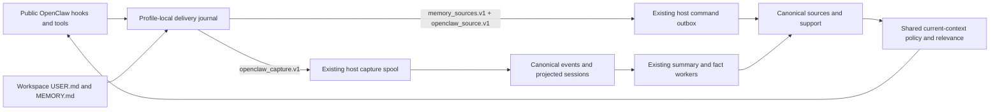

# OpenClaw memory integration

This review covers the packaged OpenClaw provider, the local host agent and
canonical Backplane Memory. The qualified upstream contract is OpenClaw
`v2026.10.7`, commit `157d8c2bc3ea2fa183afdc11088e69690bf8e64e`, with Node
`24.22.1`. Other OpenClaw releases have not been qualified by this review.

Implementation started on `main@77721c0e674996c81b7f0a0b824a748a641420a6`
(`v1.10.39`). The plan's older `9424dfd5` baseline predates the shared Hermes
source/evidence correction. The existing normal Hermes live scenario already
passed 14/14 at that baseline's successor; its earlier 13/14 result is historical.
See [the shared Hermes review](hermes-memory-integration.md) for that evidence,
the source support model, canonical current-context policy and relevance rules.
OpenClaw still requires its own runtime and semantic qualification below.

During qualification, `main` was fast-forwarded to published `v1.10.40`, commit
`0605d9d4b33d401a20f2659dd15d77250b3ff691`. Its five newer commits affect
AgentRuntime, AI codecs and the development environment; the OpenClaw changes
were preserved without conflicts. Final qualification uses this integrated base.

## Ownership and flow



The JavaScript journal stores immutable delivery state, source identities and
turn fences. It is not a canonical memory database or an offline recall cache.
The host uses its existing durable outbox, capture receipts and authenticated
WebSocket. Canonical Memory owns source membership, revisions, evidence,
withdrawal, global forget, extraction and recall. No additional gateway service
or database migration is introduced.

Native files own their text. A native-backed record is corrected through the
OpenClaw file workflow and a successful read-back reconciliation. Provider-owned
facts have their own `provider` source and exact entry IDs. Withdrawing one source
contribution preserves independent support. Explicit global forget suppresses
the canonical record across later reconciliation; it does not edit native files.
Raw conversation evidence, curated documents and derived candidate facts retain
distinct provenance and trust. A durable receipt does not establish truth.

## SDK, identity and caller authority

`plugin.mjs` registers the public `before_prompt_build`, `agent_end` and
`session_end` hooks, context-version-2 executable tools, a provider record runtime,
a tools-based flush resolver and one bounded delivery service. The old
`before_agent_start` registration is removed. The real stable registrar ignored
that old hook; permissive mock registration did not reveal the defect.

Conversation access is explicit under
`plugins.entries.backplane-memory.hooks.allowConversationAccess`. Missing or
denied access registers no automatic conversation hooks and reports a diagnostic.
Independent tools/provider calls retain their own authorization. Setting
`config.enabled=false` registers no active provider, tools, hooks or service.

Version 1 accepts a host-minted, current, owner-private audience for the actual
agent and an explicit mapping to an already granted Backplane access UUID.
Conversation/group/thread audiences, missing or cross-agent audiences and sandbox
callers are refused. Several owner agents may intentionally map to the same
existing grant. Profile, cwd, URL agent labels and serialized audience objects
cannot create permission. The local HTTP endpoint retains its trusted-local-host
boundary; this integration does not isolate hostile local processes.

Live audience/invocation assertions are checked before I/O, durable admission and
result release. Finalized tool authority separately permits automatic search,
capture (`save`) and native synchronization (`save`, `correct`, `withdraw`).
Read-only access does not require source-write readiness. Automatic capture and
native scanning require the selected access to match the negotiated default
capture binding. New work fails closed after revocation/reset. Already-admitted
historical events retain their original access, authority version and partition
fingerprint; replay never relabels them under a replacement grant.

`ctx.sessionId` and `ctx.sessionKey` identify the real session; `ctx.runId`
identifies one run. The adapter never substitutes a run ID, timestamp or content
hash for a session. A preturn history fence and original prompt are committed
atomically with input capture. `agent_end` admits only the verified new
assistant/tool suffix. Model-only recalled context is not recaptured as original
user evidence, and empty/tool-only output cannot borrow a prior answer.
Input provenance is retained independently from the user role.

Canonical ingestion preserves that raw role while classifying the actor from
typed input provenance. Explicit `internal_system`, `inter_session` and
unrecognized typed origins cannot supply user assertions or user corrections to
fact extraction. Missing provenance stays `unknown`: it may support a traceable
candidate inference, but cannot establish human confirmation. OpenClaw evidence
qualifies for the existing established-fact rule only when it explicitly carries
`external_user`; a stored `actor_type=user` alone is insufficient. Extraction
bundles retain the original provenance and origin classification. Existing Hermes
origin handling is preserved.

OpenClaw maintenance flushes expose the trusted `trigger: "memory"` but omit
`inputProvenance` in this stable release. Automatic conversation recall/capture
explicitly skips those maintenance invocations. The provider's authorized tools
still persist flush conclusions with assistant provenance; maintenance prompts
cannot become ordinary user evidence.

The stable hook API supplies no durable transcript cursor. A crash before an
observation hook runs can leave its suffix unobserved. The adapter does not import
private transcript modules or invent missing message IDs. `session_end` has no
new content grant: it may append a content-free closure only for an exact already
admitted session with its original binding.

Where the hook supplies no native message timestamp or ID, the occurrence is a
run-fenced adapter observation: its timestamp is fixed at first admission and its
occurrence reference is not presented as an upstream message ID.

## Source contracts and durable delivery

Source transport remains `memory_sources.v1`; independent negotiation of
`openclaw_source.v1` is mandatory. Capture uses `openclaw_capture.v1`, never the
Hermes protocol. An old Hermes-only peer cannot advertise OpenClaw readiness.
The source identity is `{integration, installation_id, profile_id, target}`;
OpenClaw permits `memory`, `user` and `provider` targets. The durable profile
namespace includes configured profile, actual agent and workspace identity,
independently from sessions.

Source identity follows the workspace reported by the public SDK. Configure an
explicit agent workspace when the same native documents must retain their source
identity across restarts. A different workspace creates a different source
namespace; it does not silently migrate or withdraw the previous workspace's
sources. The live fixture pins both agents' workspaces and includes an actual
gateway-restart assertion for unchanged native entry identity.

Additive provenance admits real run/session/occurrence references, message index,
input provenance and complete `USER.md`/`MEMORY.md` revision hashes. Reserved
server ownership fields, unknown keys, excessive sizes and nonportable JSON are
rejected. JavaScript and Elixir hash compact JSON with UTF-8-sorted keys and
integers within JavaScript's safe range. Complete batches are validated before
durable publication; existing Hermes contracts remain compatible.

SQLite uses FULL synchronous WAL, an immutable insertion sequence, bounded
pending events/bytes and a database page ceiling. Event ID, source sequence,
payload hash and original time survive lost ACKs and restarts. A changed payload
under the same occurrence conflicts. Hook promises cover durable local handoff;
delivery and canonical processing remain asynchronous. Status distinguishes
`local_pending`, `host_accepted`, `canonical_committed`, `deferred`, `rejected`
and `dead_letter`. Retry exhaustion does not prove remote rejection.

Journal transactions check SQLite's actual transaction state before rollback:
`SQLITE_FULL` may already have rolled back the transaction. Storage failure
must preserve the original error, leave the cursor/event unaccepted and retain
previously admitted envelopes. Queue and real SQLite page-ceiling fault tests
exercise this local storage boundary separately from gateway recovery.

The host validates capture bindings at admission, before upload and again during
canonical ingestion. Binding changes reject old work rather than retarget it.
Shutdown aborts owned requests and settles its worker before closing the journal;
crash recovery does not depend on graceful shutdown. Disabling preserves queues,
receipts, source identities and suppression.

Manager cleanup revokes existing provider leases without stopping the delivery
service. A new lease remains available after cleanup. Actual plugin disposal
owns service shutdown. Changing the configured journal identity (profile,
endpoint or access mappings) is refused: retain the old journal and explicitly
choose a separate journal for new bindings rather than relabeling accepted work.

## Native revision policy

Only workspace `USER.md` and `MEMORY.md` are scanned. Each complete stable document
is one durable entry, with a SHA256 document revision; no paragraph similarity or
hidden file IDs select destructive targets. The first authorized prompt after
startup/re-enable performs fresh reconciliation. No background task fabricates a
session grant for native reads.

Native changes reuse ordered mutation and begin/page/commit reconciliation.
Successful complete inventory distinguishes an empty or confirmed-deleted file
from unreadable, unstable, symlinked, invalid-UTF8 or oversized input. Unsupported
documents over 262144 UTF-8 bytes defer the entire inventory; a partial snapshot
cannot withdraw sources. Local source-head suppression prevents obsolete context
from returning while accepted edits await canonical settlement. Independent
support remains eligible.

The adapter removes well-formed private blocks and recognizable credentials
before journaling wire content. Malformed/nested private blocks fail closed;
there is no raw fallback. The host additionally applies its capture filter.
Pattern redaction is not a guarantee that every possible secret is recognized.
Capture completeness lengths and hashes describe the complete admitted,
adapter-redacted wire text, not a pre-redaction archive. Additional host redaction
records retained length/hash and redacted coverage separately.

## Tools, provider flush and recall

The provider exposes `backplane_memory_search`, `get`, `save`, `correct`,
`withdraw`, `forget` and `status` (each with the `backplane_memory_` prefix).
Exact get uses an authorized canonical UUID, never a list scan. Provider mutations
use exact source entry IDs; native-owned entries return an ownership error.
Global forget additionally requires `confirm_global=true`. Pending results use
explicit `pending:` provider references and cannot be read as canonical IDs.
Lesson/summary/trace IDs are not mislabeled as canonical memory records.

The public flush resolver declares Backplane save/correct persistence tools and
search/get/status lookup tools. The actual host supplies `flushId`; a stable
`fact_key` separates facts and deduplicates retries. Lookup success alone is not
persistence. The supported final `NO_REPLY` may complete a legitimate no-op.
Backplane acceptance and canonical commit remain separate. OpenClaw may compact
after skipped or failed optional flushes; this provider does not promise a
compression checkpoint. Memory Core sidecar file activity is separate.

Shared CurrentContext, SourceSupport and calibrated Relevance govern all recall.
The adapter consumes lifecycle, trust, support, relevance and source references;
it adds no score cutoff or cache. Stale or unsupported rows cannot silently become
current facts. Provider health without session content authority is content-free.
Outage/denial is an explicit tool/runtime error.

`token_budget` is 128–32768 UTF-8 bytes, default 2000, including the complete header,
labels, citations and separators. It conservatively bounds byte-tokenizer tokens.
Backend request budgeting and final adapter packing both apply. Whole oversized
entries are skipped. Irrelevant queries may inject nothing. The historically
reserved `min_confidence` is deprecated with a diagnostic; it is not cosine
similarity or fact confidence.

## Installation, legacy data and rollback

See [the packaged README](../../integrations/memory/openclaw/README.md) for the
effective configuration, existing-access discovery and explicit conversation
grant. Install all runtime helper modules through the host installer; copying
only `plugin.mjs` is insufficient. Package versions follow the existing unified
release version normalization. Repository changes do not upgrade a user's plugin.

`rollout.mjs --operator-read-only` offers a bounded, resumable list/get audit under
an existing access UUID. It preserves canonical IDs and known session fields and
reports ambiguous origin/coverage. Public legacy records do not expose enough
information to reliably recover `metadata.source=openclaw.agent_end`; a URL agent
label is insufficient. Trusted original exports are required for reliable import.
The audit cannot apply changes, delete evidence, guess sessions from old run IDs,
replay rejected commands or reconstruct truncated content.

Disable the plugin to stop new operations while retaining its journal. Do not
downgrade canonical readers to versions that ignore effective source support
after withdrawals. Production data migration and user installation are separate
operator actions.

## Verification and publication

Local qualification completed on 2026-10-26 against the implementation integrated
with `main@0605d9d4`. The complete full-mode run exited 0: **19/19 deterministic
checks and 1/1 real-model semantic check passed**. The deterministic count includes
the separate concurrent-agent, binding-revocation and owned-cleanup checks.
Deterministic transport checks and real-model semantic extraction remain separate
evidence surfaces; these local results do not establish publication or deployment.

The coherent `project=backplane` Agent Note implementation review is
`fa6fa061-53cd-481e-81f4-9d3b6bfe6bb2`. Its current revision tracks the source
checkpoint and subsequent CI/publication evidence without creating progress notes.

| Gate | Observed qualification boundary |
|---|---|
| T01 | Actual stable loader/registry, declared executable tools, granted/missing/denied conversation permission and disabled-provider variants passed |
| T02 | Actual session/run/agent context passed; two agents had genuinely overlapping model requests, distinct sessions/runs/source namespaces and intentional sharing of one existing grant; separate profile-journal/reopen tests passed |
| T03 | Cumulative-history turn boundaries, separate original input, empty/tool output and lifecycle fences passed through the real host and focused adapter tests |
| T04 | Actual HTTP/canonical egress redaction, role preservation and exclusion of model-only recall projection passed; typed synthetic-origin RED/GREEN regressions additionally prevent false human confirmation |
| T05 | Immutable replay had one effect; changed payload conflicted; distinct equal-text occurrences retained separate provenance |
| T06 | Host-never-received, lost ACK, abrupt plugin/gateway restart, owned host-agent restart and public reload passed; queue and actual SQLite `SQLITE_FULL` admission tests passed separately |
| T07 | Old-peer capability refusal and incompatible capture binding passed without fallback |
| T08 | Real owner-private sharing and rejection of conversation/group/thread, cross-agent, sandbox and stale/reset caller contexts passed; canonical binding revocation refused new durable capture |
| T09 | Native add/edit retained stable entry identity; actual restart under the unchanged explicit workspace retained entry ID, revision, canonical memory and activity state |
| T10 | Oversize/incomplete inventory preserved the current head; late revisions remained stale; unreadable/unstable/symlink/invalid-UTF8 inventory behavior also has focused coverage |
| T11 | Empty/confirmed deletion withdrew sole support, independent support survived, and global forget remained suppressed after later reconciliation |
| T12 | Real OpenClaw → local HTTP → durable host → authenticated WebSocket → canonical events/session projections passed; full mode also executed actual asynchronous summary/extraction and embedding with resolvable event links |
| T13 | Independent real-model corrected preference passed the unchanged Hermes semantic oracle; assistant speculation was not promoted, incidental IDs did not invent subject/scope, and source support/trust were checked |
| T14 | Actual policy-admitted save/correct/search/get/withdraw/forget/status paths passed; provider entry correction retained exact identity and native-file mutation was refused |
| T15 | Actual optional pre-compaction invocation persisted a canonical provider fact; lookup-only failure, legitimate `NO_REPLY`, denied/skipped flush and immutable retry checks passed; maintenance prompts were not captured as user assertions |
| T16 | Final 1000-byte runtime budget, current source provenance, corrected-state suppression and unrelated zero-injection passed; focused tests cover the full budget range and complete-entry packing |
| T17 | Focused contract/domain/host/API and shared Hermes/Codex/Claude Code regressions passed; warnings-as-errors compilation, root formatting, strict Credo, workflow contracts and isolated development Dialyzer passed |
| T18 | Existing installer copied ten matching package files including all seven runtime modules; the copied package loaded in the real qualified host; assembled release-package checks are also enforced by the Release workflow |

The real semantic run used OpenRouter `openai/gpt-4.1-mini` and
`openai/text-embedding-3-large` (2560 dimensions). Its original correction oracle
was not weakened. This qualifies the exercised scenario, not arbitrary model
outputs or universal semantic correctness. OpenClaw callback/flush transport uses
a deterministic local SSE model service; synthetic usage creates real host
pre-compaction pressure and is not a performance measurement.

Focused evidence includes Node 25/25; source/capture contracts 8/0; memory 42/0;
API 68/0; additional shared memory 22/0 and host router/uploader 54/0; installed
packaging 4/0; root workflow contract 8/0; release configuration 36/0. These are
overlapping selections, not a unique-test total. The earlier host selection's
70/1 result encountered the active SQLite fault-test RED; the affected packaging
selection passed after the repair. Origin-policy RED was 40/5, then 40/0 GREEN.
The release-artifact regression likewise reproduced 36/1 before passing 36/0.

Fresh strict Credo checked 2047 files with 51 checks. Development Dialyzer passed
with a task-owned build and fresh core/project PLTs in 471.4 seconds, retaining
the repository's analysis/ignore rules: `Total errors: 118, Skipped: 118,
Unnecessary Skips: 51`, followed by `passed successfully`. The first shared-build
attempt had an incomplete PLT/missing consolidated BEAM and is invalid analysis,
not a passing check or a source diagnosis. The running operator service and its
shared build/PLTs were left intact.

Earlier full runs failed startup/admission recovery; the subsequent concurrent
fixture exposed an unscoped native-source query and inherited workspace ambiguity
with five cascading harness failures. Those runs are retained as failed evidence.
The final run pins public workspace configuration, scopes lifecycle assertions to
the original profile and retains the original correction/deletion assertions.
Its recovery checks observed no transient session-read rejection; the exact-error
retry branch has separate seven-case deterministic coverage.

Final local evidence: `/tmp/openclaw-live-workspace-qualified.log` and
`/tmp/openclaw-live-workspace-qualified-results.json`; static evidence:
`/tmp/openclaw-isolated-dialyzer-results.json` and
`/tmp/openclaw-final-tree-credo.log`; artifact-contract evidence:
`/tmp/openclaw-delivery-gate-{red,green,final}.log`. All four owned-resource cleanup
checks passed: Node stopped, owned processes stopped, isolated database dropped
and fixture directory removed. Temporary paths are session evidence, not published
release artifacts. User installation and production data migration/deployment
have not been performed.

### Reproduce the isolated live checks

Use the supported development shell, available PostgreSQL/pgvector, Node
24.22.1 and an installed `openclaw@2026.10.7` package. Set `OPENCLAW_NODE` to that
Node executable and `OPENCLAW_RUNTIME` to the package directory. The harness
refuses existing fixture directories/databases, reserves ephemeral ports and
cleans only its owned resources. It does not use operator services on
4220/4221/4222 or install a user plugin.

The driver waits for public `/startupz` and `agents.list` writable admission,
which can lag the HTTP listener. Main-session restart recovery is a separate
post-ready activity in the pinned host. Its exact pre-admission
`SessionEntryChangedDuringReadError` can still refuse `chat.send`. For that
specific `UNAVAILABLE` error only, the driver uses documented idempotent replay
with identical frozen arguments/key and bounded retries, retaining rejection
counts and canonical one-effect checks. The host does not mark that error
`retryable`; this is explicit acceptance-driver handling, not a production
plugin change or a generic retry of failed mutations.

```bash
MIX_ENV=test BACKPLANE_MEMORY_QUALIFICATION_REAL_POOL=1 \
MIX_TEST_PARTITION="_openclawlive_$(openssl rand -hex 8)" \
OPENCLAW_LIVE_MODE=deterministic \
  mix run --no-start test/openclaw_memory_live_acceptance.exs
```

Deterministic mode drives the actual OpenClaw host using a compatible local SSE
model service. It reports T13 as `not_run`, never as a semantic pass. Synthetic
model usage can deliberately create context pressure to exercise the real
pre-compaction callback; it is not a real-model performance measurement. Full
mode additionally requires `OPENROUTER_API_KEY` from the environment and runs real
asynchronous summary, extraction, embedding and the unchanged correction oracle:

```bash
MIX_ENV=test BACKPLANE_MEMORY_QUALIFICATION_REAL_POOL=1 \
MIX_TEST_PARTITION="_openclawlive_$(openssl rand -hex 8)" \
OPENCLAW_LIVE_MODE=full \
  mix run --no-start test/openclaw_memory_live_acceptance.exs
```

The existing qualified Release workflow pins Node and OpenClaw, runs the
deterministic canonical path and archives its log as the separate
`openclaw-memory-qualification` artifact for 90 days. The existing six-file Memory
V2 qualification archive and 25-asset publication contract remain unchanged.
The workflow separately tests the OpenClaw provider from the assembled host-agent
release before archiving.
Full local semantic evidence is required for this implementation acceptance;
the deterministic CI gate does not replace it.
