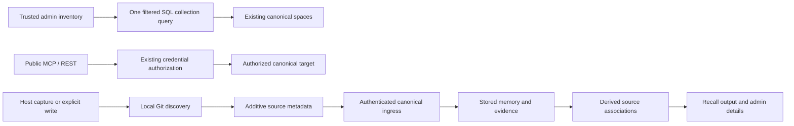

# Direct Memory browsing and source provenance

## Scope and review baseline

The authoritative attached correction requires Memory to open without host, project, space, client, scope, or namespace setup. Host and repository identify sources and optional filters, not authorization. The checkout was inspected at `c7044093f0aedcb97434a0c0caba03b864c99bb3` on branch `codex/memory-local-live-acceptance`; substantial earlier uncommitted Memory work is retained.

The reviewed mandatory `exact_partition/1` gate remains in the current checkout. The screenshot's host/project picker and unavailable-selection wording were also found in local uncommitted operator components and hook code. This establishes the inappropriate dependency in this checkout, not the cause of an unobserved deployed database failure.

## Verification and delivery

The pre-correction read-only dev inventory contains 205 memories in two distinct host-associated spaces, including 17 tombstones. A separate content-free history baseline records fingerprints of all 205 memory rows (excluding embeddings and read counters) and 710 evidence rows. Private artifacts are `.devenv/provenance-correction/canonical-before.json` and `history-before.json`. The earlier 203-row baseline also compared unchanged before this correction. After the source implementation and focused tests, the live database still has exactly 205 memory rows and 710 evidence rows: no baseline IDs are missing and no protected row fingerprints changed (`history-after-source.json`). The later local runtime check is recorded below and separately verifies preservation after synthetic writes and cleanup.

## Source representation and compatibility

New source attribution uses the additive `repository_sources` array in existing event payloads and memory metadata. Each association describes `repository_id`, `checkout_root`, and `cwd` when available; multiple evidence sources are retained instead of inventing one origin. Historical `project` values remain unchanged. Repository identity is obtained locally from Git context at the supplied capture/write directory, not from the service process's working directory. Historical imports do not rediscover today's remote and rewrite old provenance.

Remote normalization and source validation are pure shared transformations; Git execution belongs to the host boundary. Remote selection uses `origin` when present, otherwise the sole configured remote; multiple remotes without `origin` remain unresolved. Standard SSH/HTTPS spellings normalize to the same credential-free `host/path` identifier. Case-sensitive repository paths, distinct servers and nonstandard ports remain distinct; raw local/relative remotes never become repository identities. Missing Git/remotes/non-Git paths remain valid sources without a fabricated remote identity. Admin source filtering is additive and does not create a new public recall API or change credential authorization.

No storage-space merge, ownership backfill, table recreation, or mandatory host configuration is part of this correction. New provenance is additive JSON metadata and requires no schema migration or historical backfill. The compatibility prerequisite uses upstream `phoenix_socket_client` 0.8.8 and its exact HTTP transport closure, removing the old direct transport override; upstream issues #98 and #107 are closed.

## Current delivery status

Implementation acceptance remains incomplete. No correction commit, push, or release has occurred.

Local root-checkout evidence (2026-10-21):

- Contract 4/0 and host 93/0 from the source implementation; final domain 139/0, Inventory 6/0 and Admin 120/0. Both changed owning apps passed test-environment warnings-as-errors compilation; scoped formatting/whitespace checks passed.
- Supported gateway and both local hosts restarted. Playwright opened `/memory` plus 15 ordinary tabs without query parameters: all HTTP 200, connected LiveViews, no setup gates or page JavaScript errors. Default total 188 matched SQL before synthetic writes.
- Two local hosts wrote distinct memories from two worktree/checkout paths of one offline synthetic Git repository. Canonical rows retained the same normalized repository ID, distinct paths and authenticated host IDs in separate existing spaces. Duplicate requests kept the same request identity.
- Browser checks matched global newest/oldest SQL order, totals, pagination/back, cross-host search, combined host/repository filters, clear filters, native filter submission and detail refresh. Stopping host B left its existing and new durable memories visible.
- Detail host/repository attribution rendered, but checkout/cwd paths were hidden when a repository ID was present. The browser assertion reproduced this remaining acceptance gap; the full browser inventory run therefore exited 1, not passed.
- Own synthetic records were tombstoned through supported host APIs; no historical rows were manually changed. The final fingerprint comparison preserved all original 205 memories and 710 evidence rows unchanged. Exactly two new memory/evidence rows remain from the synthetic checks. Host B returned to its original configuration and the owned relay stopped.

An independent detached delivery worktree at the review baseline contains the correction, excluding unfinished shared-access/consolidation/stage/revision features. Its isolated focused checks passed: Contract 4/0, Memory 120/0, Host 38/0 and Admin 90/0 (252 tests total). Test-environment warnings-as-errors compilation passed for memory_contract, memory, host_agent and admin; scoped formatting passed for 55 files and whitespace checks passed. Admin test logs include asynchronous GeneratedSkills sandbox teardown warnings despite exit 0 and zero test failures; these are not evidence that the complete repository gate passed. Root runtime evidence and isolated artifact checks remain distinct. Additional implementation work on the detail presentation awaits explicit repair budget under the development workflow. The existing release workflow requires dispatch from `main`, immutable-SHA qualification and installed-release migration artifacts. Earlier L13/L18 acceptance and the baseline-proven router Dialyzer failures are separate retained limitations; none is reported as passing or waived by this correction.
