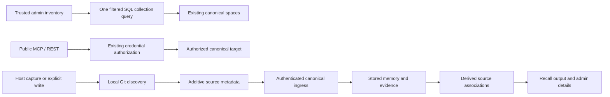

# Direct Memory browsing and source provenance

## Scope and review baseline

The authoritative attached correction requires Memory to open without host, project, space, client, scope, or namespace setup. Host and repository identify sources and optional filters, not authorization. The checkout was inspected at `c7044093f0aedcb97434a0c0caba03b864c99bb3` on branch `codex/memory-local-live-acceptance`; substantial earlier uncommitted Memory work is retained.

The reviewed mandatory `exact_partition/1` gate remains in the current checkout. The screenshot's host/project picker and unavailable-selection wording were also found in local uncommitted operator components and hook code. This establishes the inappropriate dependency in this checkout, not the cause of an unobserved deployed database failure.

## Implementation tasks

ROUTE task=memory-direct-admin-72 agent=host_diagnosis reason=Sol implementation

- Initial worker: Sol; current worker: Astra (`relay70_recovery`); Sol repair rounds 2 exhausted, Astra repair rounds 3/8: detail-path source recovery passed; cold runtime/browser acceptance pending. Admission: `SOL_REPEATED_FAILURE`. Final Sol validation passed Inventory 6/0 but failed Admin 120/10: Activity decimal aggregation, Replay isolated-mount compatibility, superseded mandatory-selection assertions, and preserving unsaved access drafts during refresh. Initial compile found an Ecto fragment placeholder/argument mismatch. A subsequent umbrella compile found missing selective imports in the modified Lessons/Crystals views; these are implementation failures, not agreed TDD reds. The bounded recovery subsequently passed Inventory 6/0 and Admin 120/0. Final parent review found that the shared source display picks repository identity instead of also displaying stored checkout/cwd paths in detail views. User-authorized repair3 now renders all stored repository/checkout/cwd associations, unresolved sources and historical project text in details, with escaping. Activity’s unused always-truthy assignment and Lessons’ unreachable error clause were removed. The34 focused tests, owning warnings-as-errors compile and formatting passed. Bounded raw Dialyzer over13 current BEAMs passed with zero diagnostics; the earlier incomplete six-BEAM analysis remains in evidence. Five authorized rounds remain; passing source checks do not establish runtime acceptance.
- Ownership: Admin source/tests; new domain `Operations.Inventory` and its tests.
- Acceptance: direct entry and ordinary inventories; database-wide bounded ordering, pagination, search and counts across legacy spaces; optional filters; record-derived exact mutation targets; no public authorization expansion.

ROUTE task=memory-source-provenance-73 agent=provenance73 reason=Sol implementation

- Initial worker: Sol; current worker: Astra (`relay70_recovery`); Sol repair rounds 2 exhausted; Astra repair rounds 2/2 successful after one failed fixture validation. Admission: `SOL_REPEATED_FAILURE`, with two failed completed Sol validation rounds. Initial validation found local-path normalization and fixture failures. Sol repair1 passed contract 4/0 and host 8/0, but its domain group was 34/1 because a new evidence assertion used raw schema fields instead of the existing public wrapper. Sol repair2 passed contract 4/0 and host 93/0; domain 138/8 failed because the new action-source helper expects fields omitted from the existing action-chain projection. Sol writes and commands stopped before the bounded handoff. Astra repair1 fixed the projection and lesson primary-key lookup; focused 49/1 retained one new fixture failure because it attempted real host capture into a non-private namespace. Repair2 corrected that fixture without relaxing ingress authorization; focused 49/0 and expanded domain 139/0 passed, along with owning warnings-as-errors compilation and scoped formatting/whitespace checks. Remote identity tests retain local-path rejection and explicit-port round-trip checks.
- Ownership: host capture/explicit-write provenance and domain persistence, derivation, recall compatibility and focused tests, excluding the inventory module.
- Acceptance: offline Git discovery; conservative credential-free repository identity; historical paths preserved; authenticated host retained; available source associations and evidence survive derivation.

These are new product-correction tasks, not resets of earlier recovery counters. Earlier task64/66 source recovery completed with Sol2 exhausted and Astra1/2 successful; its 45 host and 65 API tests passed, without new live acceptance claims. Task71's unfinished offline driver tests remain outside this correction.

ROUTE task=memory-provenance-delivery-74 agent=provenance73 reason=Sol baseline extraction and isolated validation

- Delivery worktree: `.trees/provenance-delivery`, detached at the review baseline; root changes remain untouched. Sol repair rounds 2 completed successfully, Astra 0. Repair1 removed an alias left after excluding unrelated stage UI and adapted the host upload fixture to baseline Syncer's real payload contract. Initial host group was 38/1 (fixture queried nonexistent `memory_outbox.payload`); isolated domain group then passed 120/0 and Admin group was 90/2 (outdated literal-404 expectation and incomplete render fixture assigns). Repair2 corrected those extraction compatibility fixtures; Host 38/0, Admin 90/0, four owning-app warnings-as-errors compilations and scoped formatting/whitespace checks passed. All worker commands finished and writes stopped. These counters do not renew exhausted source73/Admin72 budgets.
- Excluded unfinished shared access, consolidation, stage UI, summary revision panels and crystal revision refresh. The reviewed upstream socket dependency prerequisite is included deliberately. No commit or publication is implied by extraction.

## Verification and delivery

The pre-correction read-only dev inventory contains 205 memories in two distinct host-associated spaces, including 17 tombstones. A separate content-free history baseline records fingerprints of all 205 memory rows (excluding embeddings and read counters) and 710 evidence rows. Private artifacts are `.devenv/provenance-correction/canonical-before.json` and `history-before.json`. The earlier 203-row baseline also compared unchanged before this correction. After the source implementation and focused tests, the live database still has exactly 205 memory rows and 710 evidence rows: no baseline IDs are missing and no protected row fingerprints changed (`history-after-source.json`). The later local runtime check is recorded below and separately verifies preservation after synthetic writes and cleanup.

## Source representation and compatibility

New source attribution uses the additive `repository_sources` array in existing event payloads and memory metadata. Each association describes `repository_id`, `checkout_root`, and `cwd` when available; multiple evidence sources are retained instead of inventing one origin. Historical `project` values remain unchanged. Repository identity is obtained locally from Git context at the supplied capture/write directory, not from the service process's working directory. Historical imports do not rediscover today's remote and rewrite old provenance.

Remote normalization and source validation are pure shared transformations; Git execution belongs to the host boundary. Remote selection uses `origin` when present, otherwise the sole configured remote; multiple remotes without `origin` remain unresolved. Standard SSH/HTTPS spellings normalize to the same credential-free `host/path` identifier. Case-sensitive repository paths, distinct servers and nonstandard ports remain distinct; raw local/relative remotes never become repository identities. Missing Git/remotes/non-Git paths remain valid sources without a fabricated remote identity. Admin source filtering is additive and does not create a new public recall API or change credential authorization.

No storage-space merge, ownership backfill, table recreation, or mandatory host configuration is part of this correction. New provenance is additive JSON metadata and requires no schema migration or historical backfill. The compatibility prerequisite uses upstream `phoenix_socket_client` 0.8.8 and its exact HTTP transport closure, removing the old direct transport override; upstream issues #98 and #107 are closed.

## Current delivery status

The scoped correction now passes cold local-runtime acceptance, including the previously failing detail paths. The broader L01–L18 local goal now has accepted composite evidence; release qualification remains blocked by required CI gates. See [the current acceptance report](local-e2e-acceptance.md) for final recovery, history attribution and delivery status. The initial scoped correction was committed (`55dde54f`, `a9879ac0`), merged with remote auth changes and pushed to `origin/main` at `d8151295`. No release has occurred. The temporary delivery worktree was removed after verifying all 272 pre-merge local files retained identical contents.

Local root-checkout evidence (2026-10-21):

- Contract 4/0 and host 93/0 from the source implementation; final domain 139/0, Inventory 6/0 and Admin 120/0. Both changed owning apps passed test-environment warnings-as-errors compilation; scoped formatting/whitespace checks passed.
- Supported gateway and both local hosts restarted. Playwright opened `/memory` plus 15 ordinary tabs without query parameters: all HTTP 200, connected LiveViews, no setup gates or page JavaScript errors. Default total 188 matched SQL before synthetic writes.
- Two local hosts wrote distinct memories from two worktree/checkout paths of one offline synthetic Git repository. Canonical rows retained the same normalized repository ID, distinct paths and authenticated host IDs in separate existing spaces. Duplicate requests kept the same request identity.
- Browser checks matched global newest/oldest SQL order, totals, pagination/back, cross-host search, combined host/repository filters, clear filters, native filter submission and detail refresh. Stopping host B left its existing and new durable memories visible.
- Detail host/repository attribution rendered, but checkout/cwd paths were hidden when a repository ID was present. The browser assertion reproduced this remaining acceptance gap; the full browser inventory run therefore exited 1, not passed.
- Own synthetic records were tombstoned through supported host APIs; no historical rows were manually changed. The final fingerprint comparison preserved all original 205 memories and 710 evidence rows unchanged. Exactly two new memory/evidence rows remain from the synthetic checks. Host B returned to its original configuration and the owned relay stopped.

The independent detached delivery worktree at the review baseline contained the correction, excluding unfinished shared-access/consolidation/stage/revision features. Its isolated focused checks passed: Contract 4/0, Memory 120/0, Host 38/0 and Admin 90/0 (252 tests total). Test-environment warnings-as-errors compilation passed for memory_contract, memory, host_agent and admin; scoped formatting passed for 55 files and whitespace checks passed. Admin test logs include asynchronous GeneratedSkills sandbox teardown warnings despite exit 0 and zero test failures; these are not evidence that the complete repository gate passed. After merging remote main auth changes, the same 252 focused tests were rerun successfully; logs are `.devenv/provenance-correction/merge-main-{contract,memory,host,admin}.log`. Root runtime evidence and isolated artifact checks remain distinct. The subsequent authorized detail presentation repair passed scoped source checks; the original failed browser evidence remains retained until a new cold-runtime run passes. The existing release workflow requires dispatch from `main`, immutable-SHA qualification and installed-release migration artifacts. Earlier L13/L18 acceptance and the baseline-proven router Dialyzer failures are separate retained limitations; none is reported as passing or waived by this correction.

The subsequent pushed CI run39466186036 reported unrelated
Relayixir296/1 and client Admin-audit424/1 failures; exact evidence and scope stop
are recorded in the local acceptance checklist. These do not invalidate the252
focused results, and those focused results do not qualify the complete CI gate.
No release was performed.

## Authorized local followup verification (2026-10-21)

Task72 repair3 (Sol2/Astra3 of8; five rounds remain) passed34 focused Admin tests,
owning warnings-as-errors compilation, scoped formatting and raw targeted Dialyzer
with13 current BEAMs and zero diagnostics. The earlier incomplete six-BEAM
analysis remains retained; this is not a full-repository Dialyzer pass.

Two compatibility tasks were independently verified before cold startup. Task75
preserves published auth migration00001 and historical Memory receipts, with
forward reconcile00007 (18 standalone compatibility cases; combined102 focused
tests include that coverage). Task76 fixture-only credential helper passed73
focused tests, compilation, formatting and syntax checks. These changes retain
client IDs/scopes and the new server-issued credential boundary.

The parent stopped owned hosts/gateway, used supported PostgreSQL alone, applied
dev migrations and ran the minimal existing-fixture credential cutover. It rotated
only the legacy fixture client, then returned unchanged on repeat. Normal gateway
and both local hosts cold-started. All207 pre-cutover memories and712 evidence
fingerprints and the client identity/scope fingerprint matched after migration.
Actual authenticated chat and2560-dimensional embedding succeeded; no bearer gave401.

The resumed browser run passed global SQL order/count/pagination/back, multi-host
search, repository plus host filtering, clearing filters, native form submission,
details and refresh. The prior failing checkout/cwd assertion passed. All16 Memory
entry/inventory routes loaded without query parameters with connected LiveViews,
HTTP200, no selection gate and no page JavaScript errors. With hostB stopped, both
hosts’ durable test memories remained visible. HostB was restored. The two new
synthetic records were tombstoned using supported host forget APIs; no baseline
record was rewritten. All207 baseline memories and712 evidence remain unchanged;
two new tombstoned memories/evidence remain (209/714 total).

Private evidence: `.devenv/provenance-correction/resumed-72/` contains migration,
credential-cutover, integrity JSON, API, browser reports and screenshots. The
successful provider report is
`.devenv/memory-local-evidence/oct20-a/api-provider-1792519240841573000.json`.
Only local dev was exercised. Full shared-authority L13, retained complete L18 and
required red release gates remain separate; none is waived by these results.
