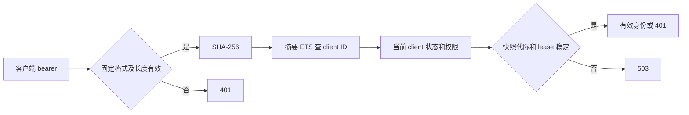

# 索引式客户端凭证鉴权

2026-10-21 完成实现与本地验证，源码基线 `main@c7044093f0aedcb97434a0c0caba03b864c99bb3`。
尚未发布、部署或修改生产凭证。设计见
[已确认方案](../superpowers/specs/2026-10-20-indexed-client-credentials-design.md)。

## 问题与实现

旧实现的无效 opaque token 会逐个验证客户端 bcrypt 哈希。客户端越多，单个错误
请求越昂贵；五秒负缓存只能减少重复输入，不能限制不断变化的错误输入。

新客户端凭证由服务端生成：`bp2_` 加 32 个 CSPRNG 字节的无 padding base64url，
共 47 字节、256 位随机性。数据库只存完整 token 的 SHA-256 摘要。这个快速摘要
方案依赖服务端随机秘密，不用于用户选择的密码。

`backplane_system` 拥有签发、持久化、摘要索引及活动统计。`backplane_auth` 保留
OAuth 与资源授权入口；MCP 工具和管理 UI 通过同一 Clients context 签发。



请求直接读取 protected ETS，不发送验证 GenServer 请求，不创建验证 task，不查
client SQL，不扫描客户端，也不建立负缓存。有效请求固定使用一次摘要索引、一次
client 查找及两次控制表查找；无效摘要省去 client 查找。格式错误不查这些表。
后台快照加载、索引重建和存储仍随客户端数量增长。

授权快照沿用 15 秒刷新、30 秒最大 lease。lease 从数据库加载开始计时，失败和慢
加载不能延长权限。发布 revision、epoch 与 ETS incarnation 防止旧刷新覆盖新变更
或跨代际读取；本地写入先建立失效屏障。连接节点通过 PubSub 失效，断连或丢失
事件仍受 30 秒上界约束。已经授权的在途请求不被追溯取消。

未初始化、过期、重启或已知失效的状态不会被当成空库。inactive、未签发和已撤销
凭证的 client 均继续使资源受保护。Activity 沿用原有有界、合并 SQL 写入机制。

## 管理与秘密交付

| Context 操作 | 行为 |
| --- | --- |
| `create_client(attrs)` | 创建身份，不签发，返回 `{:ok, client}` |
| `issue_client(attrs)` | 创建并签发，提交后返回 `{:ok, client, token}` |
| `rotate_client_token(client, attrs \\ %{})` | 原身份上原子更新元数据及替换凭证，返回三元组 |
| `revoke_client_token(client)` | 清空摘要，保留身份和权限 |
| `update_client(client, attrs)` | 只改元数据，保留凭证 |
| `upsert_from_config(attrs)` | 幂等协调身份和元数据，不签发或轮换 |

外部 `token`、`token_hash`、`token_digest`、`scheme`、`credential_scheme` 均不能
安装凭证；错误不回显这些值。`token_digest` 为可空、唯一、32 字节的 `bytea`，
Inspect 隐藏它。Client context 与快照 loader 对可能携带摘要参数或结果的 SQL
使用 `log: false, telemetry_event: nil`；其它 SQL 继续正常记录。只隐藏 struct
不足以保护 Ecto 的 SQL 参数与 Postgrex 结果行。

管理页在提交成功后显示一次 token，关闭显示、切换编辑或导航即清除。列表不能
找回秘密；未签发身份可以原地补发。普通编辑不会轮换。

`admin::upsert-client` 创建时自动签发，已有身份仅在 `rotate_token: true` 时轮换。
整个工具按敏感结果处理：

- 在幂等缓存查询前识别，覆盖解析后的 JSON batch 包装及带额外字段的现代请求。
- 携带任何 `Idempotency-Key` 均在执行前返回 HTTP 400；无 key 时直接返回并设置
  `Cache-Control: no-store`，不存响应缓存。
- TaskManager 在自身创建入口拒绝，不执行、保存参数或保存结果。
- 审计及 MCP 访问记录只保留参数哈希、状态和元数据，不保存结果正文。

断线后无法取回已签发的秘密，需要显式轮换；调用方不得自动重放签发操作。

## 本地测量

运行真实 AuthCache 和已迁移的独立空测试数据库，使用普通连接池。
每种客户端数量各测 1,000 次重复有效请求、1,000 个不同无效凭证，以及格式错误、
首次有效、刷新后和 owner 重启后的有效请求。原始结果见
[JSONL](token-auth-indexed-measurements.jsonl)。

| 客户端数 | 有效 p50 / p95（µs） | 不同无效凭证 p50 / p95（µs） | 后台快照构建（ms） |
| ---: | ---: | ---: | ---: |
| 1 | 5 / 9 | 3 / 7 | 1.004 |
| 32 | 3 / 6 | 3 / 7 | 0.507 |
| 1,000 | 3 / 6 | 2 / 5 | 6.019 |
| 10,000 | 3 / 7 | 2 / 5 | 73.207 |

所有请求测量的 bcrypt、SQL、验证 task、spawn 和扫描计数均为零。SQL 计数追踪
DBConnection 调用，并用刻意关闭日志/遥测的 `SELECT 1` 校准为一次，避免关闭敏感
SQL 遥测后得到假零值。测试还比较 1 与 10,000 客户端的固定查找次数。

这是带调用追踪的本地直接 cache 测量，Activity 在该测量句柄上关闭；不包含完整
HTTP/OAuth 处理、上游延迟或后台 Activity 写入，不能作为 vultr-01 的容量预测。
CPU 指标为测量窗口的 VM CPU 时间；内存指标是进程保留内存变化，可能因 GC 为负，
不是累计分配量。首次、刷新后、重启后和后台构建均为单次样本。

复现时先创建并迁移专用测试库，例如：

```sh
flock /tmp/backplane-indexed-auth-mix.lock devenv shell --no-tui -- \
  env MIX_ENV=test MIX_TEST_PARTITION=_indexed_bench_test mix ecto.create
flock /tmp/backplane-indexed-auth-mix.lock devenv shell --no-tui -- \
  env MIX_ENV=test MIX_TEST_PARTITION=_indexed_bench_test mix ecto.migrate
flock /tmp/backplane-indexed-auth-mix.lock devenv shell --no-tui -- \
  env MIX_ENV=test BACKPLANE_AUTH_BENCH_DATABASE=backplane_test_indexed_bench_test \
  mix run --no-start scripts/benchmark_client_auth.exs
```

脚本拒绝默认 `backplane_test`、不以 `_test` 结尾的库和已有 client 的库；只清理
本轮创建的行。不要把数据库指向生产。

## 验证与边界

核心回归覆盖签发、唯一/长度约束、外部凭证拒绝、轮换/撤销/禁用/删除、NULL 身份、
当前权限、旧刷新竞争、owner 重启、过期/慢/失败加载、远端失效、固定索引工作量及
有界活动统计。SQL 保密回归覆盖成功和失败签发/轮换、读取、刷新和 sandbox 查找，
并确认无关 SQL 仍有日志及遥测。

完整 McpPlug 请求覆盖旧/现代协议签发、无 key 的直接秘密交付、keyed 调用不轮换、
真实 JSON batch 和额外 `_json` 字段、no-store，以及日志/遥测/审计/访问记录/
幂等缓存/任务表中不保留明文或摘要。独立设计合规和代码安全审查均已完成；发现的
SQL 遥测泄露和批量请求检测绕过已修复并加入回归。

在独立 `backplane_test_indexed_auth_migration_test` 库完成真实迁移检查：先迁移到
`20261016000001`，插入旧格式客户端，再执行新迁移。ID、名称、scopes、active、
metadata、last_seen_at 和创建/更新时间逐项保持一致；新摘要为 NULL，旧哈希列消失。

最终合并执行 41 个相关测试文件，**560 项测试、0 失败**：system 102、auth 54、
llama 111、MCP 216、gateway 11、admin 20、API 46。文件清单见
[测试清单](token-auth-indexed-tests.txt)，可复现为：

```sh
flock /tmp/backplane-indexed-auth-mix.lock devenv shell --no-tui -- \
  sh -c 'xargs -d "\n" mix test < docs/operations/token-auth-indexed-tests.txt'
```

改动的 52 个 Elixir 文件通过 scoped `mix format --check-formatted`，
`mix compile --warnings-as-errors` 和 `git diff --check` 通过。SDK helper 通过 Python
AST 解析。并行任务的 Mix/Devenv 命令以同一 flock 串行执行。

额外执行真实 socket/流式套件：流式 LLM 18 项全部通过；API 36 项中 3 项失败，
均在 `audio_loopback_endpoint_test.exs`，没有修改对应媒体实现或断言：

- `pinned OpenAI SDK exercises binary speech, streaming speech and both transcription responses`：
  缺少 `/tmp/backplane-audio-sdk-venv/bin/python`，且未配置 `BACKPLANE_AUDIO_SDK_PYTHON`。
  需要已安装 OpenAI 2.26.0 的 Python 环境；没有安装、跳过或宣称验证成功。
- `repeated empty progress cannot reset the overall deadline or commit audio` 与
  `overall deadline aborts stalled provider and cleans the session`：请求已通过鉴权，
  返回预期 HTTP 504 / `audio_timeout`，但 `provider_dispatched` 观测值为 `"false"`，
  测试预期为 `"true"`。原始基线尚未验证，不能把它们宣称为已确认的基线失败。

不声称已运行完整 umbrella 测试、完整 Credo/Dialyzer、真实多节点分区、生产流量
压测或线上 CPU 复测。

## 一次性生产切换

用户已允许废弃全部旧客户端 token。以下步骤供后续部署执行，本轮没有执行：

1. 准备需要更新凭证的消费者清单；清除 TOML/app/env 中非空 `auth_token`、
   `auth_tokens`、`BACKPLANE_AUTH_TOKEN`、`BACKPLANE_AUTH_TOKENS`，并移除客户端
   seed 中的秘密字段。旧配置会在启动监听前报错，不能被静默忽略。
2. 停止所有仍可验证旧 token 的实例，再应用
   `20261020000001_index_client_credentials`。它删除旧 `token_hash`；全部现有
   client 的 `token_digest` 初始为 NULL，身份和权限保留。不能混跑旧版实例。
3. 启动支持摘要索引的新版本。通过受网络保护的管理端给保留身份补发，更新各
   消费者。此期间消费者会有无法鉴权的窗口；普通元数据 seed 不会补发凭证。
4. 检查无凭证和旧/错误凭证的拒绝、新凭证的正确权限、轮换后的旧凭证失效，
   然后对照失败请求与 CPU 观察线上效果。

迁移不可逆。回滚构建必须支持新 schema 和旧 token 已作废的语义，不能回滚到旧
bcrypt verifier 或恢复备份来重新开放旧凭证。OAuth access token、人类密码和
独立 host-agent 凭证属于其它鉴权域，本次不作废。
