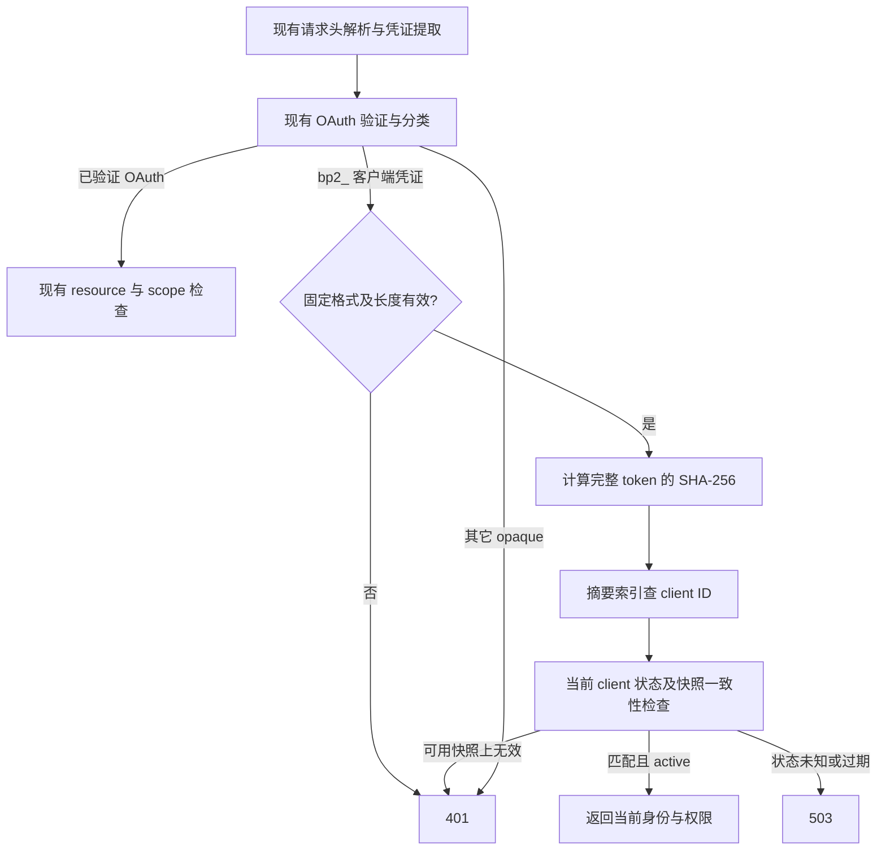

# 客户端机器凭证的索引鉴权设计

日期：2026-10-20。状态：用户已确认，工作区实现与验证见[实施报告](../../operations/token-auth-indexed.md)。
迁移边界已确认：用户允许一次性作废全部旧客户端 token；本文采用一次性切换方案。
源码基线：`c7044093f0aedcb97434a0c0caba03b864c99bb3`。
运行时代码与测试已实现；尚未迁移生产数据库、发布部署或轮换生产凭证。

## 问题与目标

当前 `Clients.AuthCache` 对未命中验证证据的 opaque token 遍历客户端 bcrypt 哈希。
每个无效 token 的计算量随客户端数量增长；负缓存、单 worker 和超时限制只能控制
重复请求和同时在途的工作，无法消除新输入触发的全量扫描。

2026-10-20 对 vultr-01 的只读诊断确认：线上 v1.10.27 有 12 个 active 客户端，
bcrypt cost 均为 12；一组周期性 MCP 401 请求单次耗时约 4～5 秒，对应 dirty CPU
线程 99% 以上的原生采样落在 bcrypt。这个结果描述旧实现，不是新方案性能数据。

目标是客户端机器凭证的成功、失败、首次请求、重启后及刷新后验证均不执行 bcrypt、
不枚举客户端、不产生请求侧 client SQL、验证任务或负缓存状态。权限、身份、新鲜度
和失败关闭边界继续有效。

本次作废涵盖 `clients` 表的旧 bearer token，以及 `:auth_token` / `:auth_tokens`
配置型共享 bearer 的兼容入口；否则相同旧值仍可能经 fallback 获得 unrestricted 权限。
人类密码和 OAuth access token 属于独立鉴权域，不在本次作废范围内。

## 方案比较

| 方案 | 每次验证 | 取舍 |
| --- | --- | --- |
| 服务端随机 token，完整 token 的 SHA-256 摘要索引 | 固定长度摘要 + ETS 精确查找 | 推荐；沿用 opaque bearer，当前单凭证模型无需额外身份字段 |
| 公开 selector + 随机 secret，selector 索引 + secret 摘要验证 | 一次定位 + 固定成本验证 | 同样可以高效验证；当前没有多凭证需求，额外 selector 暂无必要 |
| selector 定位 + bcrypt | 至多一次 bcrypt | 消除全表扫描，但已知 selector 的错误请求仍能触发昂贵计算 |

采用第一种。用户允许作废全部旧客户端 token，因此新实现直接移除旧 bcrypt 验证，
不引入双 scheme、兼容扫描期或自动升级旧哈希机制。

## 凭证格式与数据模型

- 新 token 固定为 `bp2_` 加 32 个 CSPRNG 随机字节的无 padding base64url 编码，
  总长 47 个 ASCII 字节，秘密随机性为 256 位。
- `Backplane.Clients` 的可信签发函数负责生成秘密。UI、MCP、通用 changeset、TOML
  和直接 context 调用不能通过提供前缀、明文或摘要自行声明随机性。
- 数据库只存 `SHA256(完整 token 字节)`，使用 PostgreSQL `bytea` 的 32 字节值。
  明文仅在成功创建并签发或轮换时交付；列表、普通编辑、审计、日志、遥测不得包含
  明文或摘要，也不能从数据库找回 token。
- 不新增 pepper、签名密钥、Redis 或独立凭证服务。256 位随机秘密可使用快速摘要；
  用户选择的密码不能套用这一结论。

在 `clients` 增加可空 `token_digest`，建立唯一索引和长度约束：非空值必须恰好
32 字节。`NULL` 表示未签发或已撤销凭证。删除 `token_hash`，不新增 credential scheme
字段，因为运行时只支持一种客户端凭证。

迁移后所有现有行的 `token_digest` 都是 `NULL`。保留 client ID、名称、scopes、
metadata、active 和活动统计。一个 client 仍只有一个当前凭证；轮换替换摘要并使旧
凭证失效，不新增并行凭证或隐式克隆客户端。摘要唯一冲突不能覆盖另一客户端。

没有凭证的 client 和 inactive client 仍算数据库客户端，不能使公开接口进入 open mode。

## 验证路径与资源成本

在现有 cache owner 中增加独立的 `digest -> client ID` ETS 索引，保留现有按 client ID
索引的客户端表。成功和失败请求均直接读索引；请求不向 GenServer 排队、不查询
数据库客户端、不扫描 ETS，也不在 miss 后创建负缓存条目。

索引只负责定位；返回身份前仍读取当前 client，核对摘要、active、scopes 和 metadata。
索引、客户端数据和控制表必须属于同一稳定发布代际。可用快照中未命中返回 401；
快照未初始化、过期或已知失效时返回 503。格式错误和新 namespace 的 miss 不得降级
到其它 token 来源。其它 opaque 凭证直接无效，不保留客户端 bcrypt 或配置型共享
bearer 的验证入口。

请求侧相对客户端数量的期望成本为 O(1)，摘要输入长度固定；ETS 存储为 O(N)。沿用
现有后台快照刷新时，加载和索引重建仍为 O(N)，必须单独测量。PostgreSQL 唯一索引
负责完整性，不将 B-tree 查询宣传为 O(1)。

不同的错误 token 不创建持续增长的缓存状态。请求量本身仍产生线性处理成本，本方案
消除每个请求再乘客户端数量及 bcrypt 成本的放大。

## 权限、新鲜度与故障语义

保留现有授权快照的 15 秒刷新、30 秒最大 lease，以及以下约束：

- 本地安全变更在写入前建立失效屏障。轮换旧摘要失效与新摘要发布属于同一受保护
  过程，旧 refresh 不能覆盖已提交的轮换、撤销、禁用、删除或权限变更。
- 读取检查 ETS 表 incarnation 和发布 epoch，防止 owner 重启后的 ABA 或跨表混读。
- lease 从数据库加载开始计时，失败和慢加载不能延长旧权限。PubSub 传播已连接节点
  的失效；断连或丢消息的节点仍受现有 30 秒上界约束，不承诺全局瞬时撤销。
- 未初始化、过期、owner 重启或已知失效但 reload 失败时不能转成 open mode。
  有 inactive 或未签发客户端时也不能视为空库。
- 保留 OAuth 签名、issuer、audience、期限、token/client/user 状态检查；已确认是 OAuth
  但授权失败的请求不能回退。保留现有两个凭证头、冲突头拒绝、scope 和错误 envelope。
- 活动统计沿用已有有界、合并写入机制，不新增每请求 task 或消息。

移除客户端旧验证证据缓存、负缓存、扫描 worker、flight/waiter/ticket、验证超时及
相应容量配置。保留后台 refresh、Activity 和保护它们的监督关系。

## 签发与管理入口

- 提供可信的创建并签发、按 client 轮换、撤销凭证操作。签发返回提交成功的 client 和
  一次性明文；失败时不交付秘密。撤销清空摘要并执行同样的失效屏障。
- 普通元数据更新保留现有返回契约与凭证，不接受外部 `token_hash`、`token_digest` 或
  任意自选 `token`。表单校验不再用假的 `token_hash`。
- 管理 UI 在成功创建或显式轮换后显示 token，离开或关闭显示后不能重新读取；凭证
  缺失可通过管理 UI 补发。客户端列表明确显示未签发状态，权限配置继续独立编辑。
- MCP `admin::upsert-client` 创建时由服务端签发；更新时仅显式 `rotate_token: true`
  才轮换，普通编辑保持凭证。旧 `token` 参数返回明确参数错误，不自动导入或升级。
  现有 tool 的 metadata 返回保持兼容，只有签发响应额外返回 `token`。
- TOML seed 只对客户端身份和元数据做幂等协调；新增 seed client 保持无凭证，之后
  由可信管理入口签发。带任意 `token` 的旧 seed 配置须在启动前报配置错误，不能
  忽略错误后开放接口，也不能在 boot 时重建旧凭证或自动轮换新凭证。
- 非空的旧 `auth_token` / `auth_tokens` 配置也在开放监听之前报配置错误，错误只说明
  配置项名称，不包含值。既不能继续接受旧值，也不能忽略它后意外进入 open mode。
- 直接 context 调用和测试 fixtures 同步改用上述契约；通用 attrs 不能覆盖内部摘要。

### MCP 一次性秘密的交付边界

当前原生工具审计和 MCP 访问记录只保存参数哈希、状态和元数据，没有成功结果正文。
实际会留存完整结果的是通用 Idempotency 响应 ETS，以及 TaskManager 异步任务结果。
现有 redaction 不能保证清除嵌入任意错误字符串的秘密。

因此将整个 `admin::upsert-client` 定义为同步敏感结果操作，规则统一覆盖创建与更新：

- 在任何幂等缓存查询之前识别该工具，覆盖 batch 内的请求。若携带 `Idempotency-Key`，
  在执行前明确拒绝，不能暗示轮换可安全重放；也不能读取或写入此请求的缓存结果。
- TaskManager 在自身创建入口、执行之前拒绝该工具，不能仅在 HTTP handler 上拦截。
- 直接响应设置 `Cache-Control: no-store`；此 header 不能替代上述内部缓存隔离。
- 保留 hash-only 审计及 metadata-only 观测。成功结果中的秘密使用 `token` 字段，
  异常、验证错误和日志不得插入该秘密或携带秘密的 changeset。
- 传输断开后无法找回已交付秘密；调用方应通过显式轮换恢复，不能自动重复签发。

不新增通用敏感数据平台，不关闭其它工具的审计或缓存。

## 一次性切换与回滚边界

用户已允许全部旧客户端 token 一次性作废。采用以下切换契约：

1. 清点并移除旧共享 bearer 配置，修正 TOML/client seed 和管理调用，准备需要更新
   token 的消费者清单。
2. 停止所有旧版本实例后执行 schema 迁移；不混跑仍能验证旧 token 的实例。迁移
   删除全部旧客户端 bcrypt 哈希，所有 client 身份和权限保留，摘要初始为 NULL。
3. 启动只支持新客户端凭证的版本。旧 token 立即无效；管理 UI 仍是可信运维入口，
   可按保留的 client 身份重新签发，再更新各消费者。中间存在消费者无法鉴权的窗口。
4. 验证全部旧格式及无效 token 均不能触发 bcrypt，旧配置型 bearer 无法继续授权，
   签发和轮换只影响目标 client。

`bp2_` 归新格式使用。旧自选 token 即使有相同前缀也全部作废，因此不存在保留其旧
验证语义的承诺。不能从原 bcrypt 哈希推导原 token 摘要，也不做登录时自动迁移。

删除旧哈希的迁移不可逆。此变更同时建立回滚下限：回滚构建必须支持新 schema、
摘要验证和旧 token 已作废的语义；不能自动回滚到旧 verifier，或通过恢复数据库备份
重新开放旧凭证。生产切换的具体时点、签发和消费者更新属于后续部署执行。

## 验收与实施范围

验收采用 scoped 测试与真实生产 cache 路径 benchmark；结果及未验证边界见实施报告：

- 对 1、32、1,000、10,000 客户端验证首次成功、重复成功、不同无效 token、格式
  错误、服务重启和刷新后的请求。客户端 bcrypt 次数、请求侧全表扫描、client SQL
  与验证 task 数均为零；索引查找次数有与 N 无关的固定上界。
- 无版本旧凭证和随机无效凭证不能调用 bcrypt，不积累负缓存，不挤占有效凭证索引。
- 迁移保留身份与权限但清除全部旧凭证；无凭证或 inactive 客户端仍使接口受保护。
  旧 seed、伪造内部摘要和任意自选 token 不能重新进入系统。
- 本地失效屏障之后、或节点已收到失效之后，不得接受旧摘要或权限；未获知变更的
  节点不得超过既有 lease 上界。覆盖旧 refresh、owner 重启、expired lease、慢/失败
  加载和跨发布竞争；回滚不能重开旧验证。
- 验证唯一摘要、NULL 凭证、格式隔离、创建/编辑/轮换/撤销以及一次性 UI 显示。
- MCP 明文只出现在直接签发响应，不能进入幂等缓存、任务结果、审计、访问记录、
  遥测或错误日志。覆盖 batch、默认 buffered transport、modern transport 和失败路径。
  带幂等 key 和异步调用必须在签发之前拒绝，不能先改变凭证再报错。
- 覆盖配置型 legacy 已停用与启动配置检查；保留 OAuth、现有 open mode 条件、两类
  请求头、Google 错误格式及公开 MCP/LLM 资源授权回归。密码鉴权不变。
- 修正 test-only sandbox 分支，使其遵守同一摘要语义；另保留显式生产 cache 路径
  集成测试，不能仅用 sandbox 路径证明真实请求没有扫描。
- benchmark 报告有效/无效请求 p50/p95、bcrypt、索引查找/扫描、SQL、进程保留内存变化与 VM CPU，
  单独报告后台快照构建成本。CI 用结构性断言，不依赖偶然的毫秒阈值。

预期触及 `backplane_system` 的 Client、Clients、AuthCache、Activity/监督和 migration；
`backplane_auth` 的资源鉴权分类；`backplane_mcp` 的客户端管理、幂等和任务保留边界；
`backplane_admin` 的客户端表单；配置 seed 校验及对应测试和现有鉴权 benchmark。
不扩展到其它领域或完整 umbrella 测试修复。

## 源码与历史来源

- 当前 Client schema、创建/更新/config upsert、AuthCache 与 Activity。
- 当前 ResourceAuthPlug、Tokens、MCP 管理工具、ClientsLive 和各自 scoped tests。
- 当前 MCP Dispatch、ToolAccessEvent、ToolLogWriter、Idempotency 和 TaskManager。
- `docs/operations/token-auth-p0.md`：兼容热修复及其明确遗留的 cold O(N) 限制。
- Agent Note `62aeeaed-02ba-417c-8473-a597a9bf4173` 的 P1 章节：历史设计提议，非
  已实现证明。本文依据当前源码及用户允许作废旧 token 的边界收敛为一次性切换。
