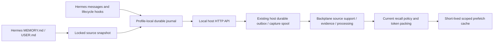

# Backplane Memory for Hermes

This provider mirrors native Hermes curated entries through `memory_sources.v1`
and captures conversation evidence through `hermes_capture.v1`. Backplane remains
the canonical memory authority. The plugin's SQLite database is a delivery/source
journal, never an offline recall database.

Tested Hermes reference: `NousResearch/hermes-agent`
`bac34e9e9946c9c6a9ce7ce64efadd47f8fa375b`. Packaged versions follow Backplane's
existing version-stamping/release process; changing this checkout does not update
an installed plugin.



## Installation and configuration

Run the Backplane host agent with its local HTTP API enabled (normally
`http://127.0.0.1:4222`) and install the packaged `memory` / `hermes` plugin through
`host_agent::install_plugin`. Enable it in the intended Hermes profile:

```yaml
memory:
  provider: backplane-memory
```

`hermes memory setup` writes nonsecret settings to
`$HERMES_HOME/backplane-memory.json`. Settings are loaded at initialization;
restart Hermes after changing them. Existing environment variables override the
sidecar through Hermes's profile-scoped `get_secret()` API:

| Setting | Default | Environment override |
|---|---|---|
| `url` | `http://127.0.0.1:4222` | `BACKPLANE_MEMORY_URL` |
| `agent_id` | `hermes` | `BACKPLANE_MEMORY_AGENT_ID` |
| `memory_access_id` | host-bound default | `BACKPLANE_MEMORY_ACCESS_ID` |
| `context_token_budget` | 1200 | — |
| `recall_limit` | 5 | — |
| `cache_ttl` | 5 seconds (1–30) | — |
| `cache_entries` | 32 (1–128) | — |
| `evidence_chars` | 131072 (1024–131072) | — |
| `max_pending` | 4096 (16–10000) | — |
| `journal_bytes` | 33554432 (1–256 MiB) | — |
| `relevance_mode` | `lexical` | — |
| `source_selection` | `[]` (all authorized sources) | — |

For example, `agent_id: Rikka` is the actual logical agent label used in local
URLs and capture provenance. It is not a profile identity or authorization grant.
`cwd` and repository information remain provenance and never redefine scope.
An explicit `memory_list.scope` is still checked by the host.

There is no import-time global dotenv loading. If previously relying on
`~/.config/backplane/host_agent_client.env`, put the required nonsecret settings in
the intended profile's sidecar or configure its environment explicitly. This
avoids sharing one profile's runtime settings with another profile in the process.

## Source identity and reconciliation

The source key is `{integration: "hermes", installation_id, profile_id, target}`;
`target` is `memory` or `user`. Installation/profile UUIDs and entry mappings are
durable under `$HERMES_HOME/backplane-memory/delivery.sqlite3`. One entry UUID
survives exact known replacements across sessions. Every immutable mutation has
its own event UUID and a durable target-wide increasing revision. Neither text
hashes, session IDs, nor model-supplied `tool_call_id` are entry identities.

Current Hermes callbacks are `add / replace / remove`. A native patch arrives as
`replace` with complete new content and complete `metadata.previous_content`.
Removal accepts empty content. Legacy `update` is explicitly unsupported; it is
never emulated using append-only `remember`.

The adapter locks the native `.md.lock` file using the same Unix/Windows mechanism
as Hermes, strictly reads the complete UTF-8/BOM-compatible native file, and splits
entries using `\n§\n`. Missing, inaccessible, undecodable, oversized, unsupported,
or failed-lock reads defer reconciliation. Only a successfully read empty file
means an empty source. Reads never create or rewrite native memory files.
The same tracked delivery worker checks both targets at startup and at a bounded
30-second interval, so files appearing later and changes with missed callbacks
converge without a restart. Pending callbacks are retried between periodic checks.
Non-primary contexts do not perform these automatic scans. The interval is a
scheduling target; an in-flight transport request or file lock can delay a scan.

Complete old-entry matches must be unambiguous. Ordered callback receipts and
exact value aliases retain chains such as old → new → third even when the native
file is already third before the first callback, including a restart between
callbacks. Intermediate values absent from the locked file are never emitted as
current support. An unresolved chain is visible as `identity_chain_pending`;
unknown additions in that chain are deferred rather than assigned guessed lineage.
When an edit's lineage was never supplied, snapshot membership can converge using
new source IDs without claiming to reconstruct the lost relationship.

Successful complete snapshots use bounded `source_reconcile` begin/page/commit
transactions. A revision fence and hashes cover every page and the complete
ordered entry array. Begin/page staging cannot withdraw entries by itself. Replays
reuse IDs, payload bytes, timestamps and hashes. Duplicate/no-op callbacks retain
receipts without manufacturing new source evidence. Native batch callbacks have
no batch-end signal or stable operation IDs; this is convergent source state,
not a claim of exactly-once interpretation of indistinguishable callbacks.

Preparation follows the frozen host source contract: 262144 UTF-8 bytes per
complete content, 480000 bytes per complete command including its envelope and
provenance, 100 entries per page, 100 pages / 10000 entries and 16777216 bytes for
the flattened encoded snapshot. Provenance also obeys supported fields, text and
repository-list limits, portable JSON types and reserved ownership restrictions.
No fact or provenance is cropped. The entire mutation/manifest set is validated
before the first enqueue; invalid preparation rolls back source heads, aliases,
revision allocation and delivery writes while retaining the callback for review.
Safe `source_snapshots` codes distinguish `invalid_source_payload`,
`source_command_too_large` and `source_snapshot_too_large`. These local deferrals
require correcting the source/provenance or reducing the selected snapshot.

Native files are private local source mapping data. Before immutable wire payloads
are hashed/journaled, content and provenance pass Hermes's public
`agent.memory_manager.redact_for_egress` re-export. The helper's failure sentinel
or absence defers native delivery; raw fallback is prohibited. Different entries
that redact to the same text keep separate IDs. The host still owns canonical
content deduplication and independent source memberships.

## Delivery, failure and status

A callback returns only after its observation or immutable capture event is in a
SQLite `synchronous=FULL` transaction. One context-preserving tracked worker
retries transport failures with bounded exponential backoff. A timeout or lost
ACK resends the exact stored payload. HTTP errors are closed explicitly and only
safe error codes/statuses enter diagnostics.
Delivery order uses a durable insertion sequence, independent of equal/backward
wall clocks or event UUID ordering. Existing journals backfill the sequence from
their original SQLite insertion order without rewriting payloads. Unaccepted
work in retry backoff fences later unsent stages, preserving manifest order after
a lost acknowledgment; host-accepted status polling remains independent.

`memory_delivery_status` / `provider.delivery_status()` distinguish:

- `local_pending`: durable plugin journal, not yet accepted by the host.
- `host_accepted`: host durable acceptance, not canonical success.
- `canonical_committed`: canonical settlement was observed.
- `rejected`: terminal rejection or exhausted retry budget; retained for review.
- `capture_deferred`: capture is incompatible/unavailable for this binding.
- `pending_reconciliation` and per-target `source_snapshots`: failed reads or
  unresolved identity chains.

There are at most 4096 unsettled/rejected events by default. The SQLite main file
also has a configured page-count ceiling; WAL/retained receipts add bounded
operational overhead. Capture identity state is capped at 100000 messages / 1000
sessions and native entry history at 10000 entries. Reaching a limit raises;
checkpoint persistence failures propagate. Settled payload retention is bounded;
rejected payloads are retained and count against capacity. No automatic operation
rebinds, relabels, discards, or replays authorization/binding rejections.

`flush(timeout=10, canonical=True)` waits for canonical settlement. `canonical=False`
only waits for host handoff. Graceful shutdown drains briefly and joins the worker
with a bound (up to two seconds draining and three seconds joining). HTTP uses a
20-second socket timeout so normal multi-second canonical recall can complete;
automatic prefetch still returns promptly from its local cache. If an in-flight
request outlives shutdown's join, its tracked worker retains the journal until
finalization, then closes it safely. After an in-flight delivery or recall returns,
the worker checks for shutdown before starting its next queued phase. Restart
recovery is required for work left behind. Unknown status
is neither rejection nor success. Persistent binding fingerprints prevent replay
into a changed authority. A changed URL/agent/selector/profile binding requires an
explicit operator migration; do not delete the journal to silence the error.

## Capture, sessions and checkpoint coverage

Conversation data uses `/capture/v1/hooks/hermes/{session-start,message,session-end,pre-compress}`,
not an episodic `remember` per turn. Events preserve separate roles, actual
`message_uid`, per-occurrence tool UIDs, absorbed message UIDs, available tool
payloads, current-turn author, session/parent session and source provenance.
Per-message content changes create new immutable source revisions. The local
sequence is adapter ordering, not a canonical stream cursor.

`on_session_switch` updates session state without rebinding the profile or scope.
Queued callbacks with explicit older session IDs keep their original attribution.
Non-primary `agent_context` skips automatic writes. Rewind/reset boundaries carry
the actual lifecycle signal. Hermes supplies no post-rewind transcript/cursor;
absence from a compressed/current context does not prove withdrawal of old evidence.

Native `message_uid` is preferred. Legacy snapshots without IDs use ordered
occurrence alignment, retaining repeated equal rows as separate occurrences.
Standalone turn strings without a message list are fresh callback occurrences;
identical repeated turns cannot be distinguished from callback retries. No
content-hash-only exactly-once promise is made for such inputs.

Checkpoint API v2 is implemented: `on_pre_compress(..., require_checkpoint=...)`
commits supplied evidence to the local journal before returning real event
references and never changes the caller's transcript. Any persistence or known
capture-binding failure raises, allowing Hermes's `compression.checkpoint_required`
to retain the uncompressed transcript. Default best-effort compression still
follows Hermes policy.

Current v2 inputs are host-normalized direct user/assistant text. They exclude
system/tool rows and prior compaction summaries, retain assistant prose, and are
not a complete tool/multimodal archive. Larger real-ID messages use explicitly
marked excerpts with original length/hash and a
`hermes-session://<profile>/<session>/<message_uid>` source locator. Resolve that
locator against the selected Hermes profile's native SessionDB `session_id` and
`message_uid`; Backplane does not host the original. Oversized messages lacking a
real original locator fail checkpoint capture. Old 500/2000-character excerpts
cannot be reconstructed from Backplane alone.

Capture currently uses the host's default/private capture partition. Source
mutations may select an existing shared `memory_access_id`, but automatic capture
requires the selected source access to equal the default capture binding.
Capabilities report a separate capture fingerprint/readiness. A known mismatch
raises `capture_binding_mismatch`, defers queued capture, and never silently writes
to default. Source-only rollout can still synchronize the selected source access.
Initially offline observations remain unverified local delivery state until the
host proves a compatible binding; they are not canonical receipts.

## Automatic context and explicit tools

`is_available()` checks local configuration only. `system_prompt_block()` supplies
static instructions. `queue_prefetch()` fills a bounded cache;
`prefetch()` returns a fresh cached result promptly and schedules misses. Cache
keys include profile-bound instance, session, query and policy generation.
Corrections/withdrawals, explicit writes/forget, observed errors and binding changes
invalidate it. Remote changes/revocation not yet observed can remain visible up to
the short configured TTL; no offline stale-cache fallback extends that window.

Automatic context requires `current_context.v1` metadata, current lifecycle,
unexpired support and validated source references. Pending local mutations mask
older contributions; proven independent support can preserve a fact. Raw evidence
is excluded; candidate inferences are labelled separately from established facts.
Unmarked legacy peer results remain available to explicit tools but are excluded
from automatic context.

Default relevance is a conservative lexical gate that can return zero, including
when embeddings/reranking lack calibrated rejection. It does not interpret fusion
scores as probabilities. `relevance_mode: server` additionally requires the server's
explicit `relevance_accepted: true`. Source selection is a provenance filter,
not authorization. Final packing counts labels/references/newlines and uses a
conservative UTF-8 byte bound within the token budget; oversized whole entries are
skipped, never sliced into misleading facts.

Explicit `memory_recall`, `memory_save`, `memory_list` and `memory_forget` retain
the generic host contracts. Source withdrawal is not global forget. Global forget
remains an intentional separate operation and reconciliation must honor its
canonical tombstone.

## Rollout, validation and rollback

Inspect a selected profile without writing a delivery journal or changing memories:

```sh
python3 integrations/memory/hermes/rollout.py --hermes-home "$HERMES_HOME"
```

An optional `--legacy-export path.json` accepts an immutable JSON list (or
`{"results": [...]}`) of at most 1000 records / 2 MiB. Export larger datasets in
separate bounded files through the existing authorized memory listing/export
surface; this tool does not fetch or modify historical records. Each invocation
returns at most 50 review rows (`--legacy-page-size 1..100`), global counts and
`next_cursor`. Pass that cursor as `--legacy-cursor` with the exact same file to
resume. A SHA-256 fingerprint binds the cursor to the export bytes; changed
exports are rejected. Keep each export and its reviewed fingerprint/cursor
together. Replaying a review page changes nothing.

Classification uses reliable existing `metadata.source`. Review rows preserve
actual record IDs and safe known session/parent/message/observation/derivation
IDs separately for the top-level record and its metadata; conflicting values
remain explicit. The allowlist excludes content and unrelated metadata. IDs are
bounded to 512 characters and relationship lists to 100 IDs; invalid or larger
fields are explicitly flagged for inspection in the retained original export.
`export_index` is only a position in this exact export, never a synthesized memory
ID. Missing provenance stays ambiguous. Native mirrors remain an unproven native
identity mapping, even if an old export reports an `entry_id`. Missing/conflicting
installation, profile or target bindings are reported per record.

Known old turn records are labelled `legacy_bounded_excerpt`. Missing truncation,
original length and original SHA information stays unknown/null; reported valid
completeness fields are retained without claiming the original was recovered.
The tool never hashes an excerpt and calls it an original, invents a source
locator/native ID, reconstructs missing originals, or relabels historical rows.

Review/import procedure:

1. Preserve an export and review every page, including actual session/parent IDs,
   conflicts, relationship limits and native/profile ambiguity. Consult the
   original Hermes SessionDB if historical original evidence must be recovered;
   this tool cannot recover it from an excerpt. Preserve uncertain rows.
2. Use `--apply-sources` below to import only complete current native files into
   the durable source lifecycle. Existing historical mirror IDs are not guessed
   as memberships of these new source entries. Retain independently supported
   historical memories, even when their text matches an obsolete mirror. Keep
   ambiguous shared canonical IDs for review; never automatically forget a
   historical ID reused by a current independent source.
3. If an operator decides an identified old row should be removed, explicitly
   select its real record ID and intended access binding, inspect its current
   provenance/support, then use the existing `memory_forget` tool with that ID.
   This is global forget and intentionally suppresses every support of the ID,
   including independent sources. It is not native-source withdrawal; inspect the canonical
   result/status and current reads separately. No command here bulk-forgets or
   provides canonical settlement proof for generic forget.

This provides resumable current-native import plus a resumable, non-destructive
legacy review plan. Historical cleanup and recovery of missing original evidence
remain explicit operator work; no automatic reassignment is safe from the old
content-only provenance.

After confirming the profile/binding and installing the updated host and plugin,
run with the intended Hermes interpreter/profile:

```sh
python3 integrations/memory/hermes/rollout.py --hermes-home "$HERMES_HOME" --apply-sources
```

Re-running resumes the same journal and source mappings. Do not run bulk legacy
operations as a side effect. To pause delivery, disable the provider in Hermes and
restart Hermes; retain its journal and native files. Downgrading the provider does
not undo canonical mutations and old peers cannot emulate source withdrawal.

Scoped contract tests require no running services or network fetches:

```sh
PYTHONDONTWRITEBYTECODE=1 python3 -B -m unittest discover \
  -s integrations/memory/tests -p 'test_hermes*.py' -v
```

Pinned fixtures carry exact upstream source/version/hash attribution. Tests execute
actual normalizer/callback methods and the egress redactor with controlled scoped
dependencies. A localhost HTTP fixture tests immutable lost-ACK/restart delivery;
it is not a real-host or full Hermes runtime acceptance claim.

For actual host/canonical smoke, use the Hermes interpreter so the public scrub
helper is available:

```sh
python3 integrations/memory/hermes/smoke_test.py \
  --base-url http://127.0.0.1:4222 --agent-id Rikka --timeout 60
```

The script owns a fresh temporary profile (optionally under `--hermes-home`), checks
native replacement/withdrawal, independent source support, capture settlement,
checkpoint immutability, generic tools and current-read global-forget protection.
It reports derived extraction as unverified; the backend integration/live matrix
must separately prove derived memory lineage and processing completion. It never
modifies the operator's native Hermes files. Confirm deployed/installed artifact
versions separately from repository tests and release packaging.
